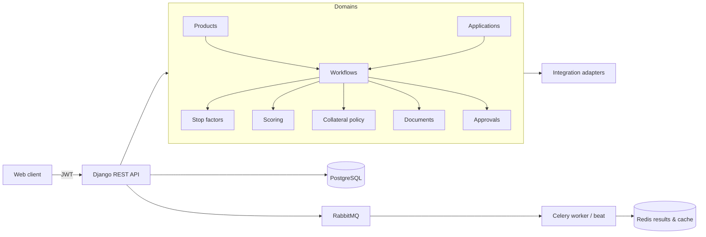

# Agrokredit API

> Backend for Agrokredit, a digital credit marketplace and loan-origination platform for Agrobank credit products.

-FC6D26?style=flat-square&logo=gitlab)

## Overview
Agrokredit lets customers apply online for Agrobank loans (individuals, self-employed, individual entrepreneurs and
company representatives) and lets the bank run each application through a configurable underwriting process. This
repository is the backend API. Its central design principle is **"credit policy is configuration, not code"**:
products, eligibility rules, scoring, collateral requirements, document lists and workflows are versioned data, so
adding or changing a product never requires a code branch. Local infrastructure lives in
[agrokredit-infra](../agrokredit-infra/); the customer frontend is planned in a separate web app (in setup).

## Key Features
- **Versioned credit products**: product → immutable published version → variants, with a forward-only
  draft → published → retired lifecycle and validated JSON configuration that is never executed
- **Stop-factor engine**: declarative hard-eligibility rules with three-valued logic (true / false / missing), explicit
  missing-data policies and pass / fail / manual-review outcomes
- **Credit security (collateral) policy engine**: first-match policies that resolve required business capabilities
  (e.g. insurance or guarantor) independent of any external provider, with mandatory fallback rules
- **Document requirements engine**: which documents are required/optional, whose they are, and whether upload or
  signature is needed, driven by application context
- **Scoring engine**: weighted factors with a closed strategy registry (value maps, range tables), exact decimal
  arithmetic, score bands, and no `eval` anywhere — verified by AST-level tests
- **Customer identity model** separating account, person, customer capacity (individual, YATT, self-employed,
  legal-entity representative) and organization, with careful handling of national identifiers
- **Credit applications** pinned to the exact product version and variant, with row-locked, race-tested submission
- **Workflow runtime**: versioned step/transition graphs validated on publish (single entry, reachable terminal,
  no dead ends) and executed with PostgreSQL row locks
- **Business configuration snapshots** that pin which engine versions governed each application
- **Platform**: JWT auth with rotating refresh tokens and blacklist, deny-by-default permissions, durable audit events,
  JSON structured logging with server-generated request IDs, separate liveness/readiness probes

## Architecture
A **Django modular monolith**: `config/` holds settings and entrypoints, and each business domain (accounts, audit,
customers, products, applications, workflows, stop factors, scoring, security, documents, approvals, integrations) is
its own Django app owning its models, services and tasks. Engines evaluate a context prepared by integration adapters
and never call external systems themselves.

PostgreSQL is the single source of truth; Redis is cache and task-result storage only; RabbitMQ is transport. The
repository also contains detailed design documents for each engine and an underwriting process model with an open
questions register, including a formalized MVP policy for a microloan product for self-employed customers.

## Tech Stack
| Layer | Technologies |
| --- | --- |
| Language / framework | Python 3.13, Django 5.2, Django REST Framework, SimpleJWT |
| Data | PostgreSQL (psycopg 3), Redis (django-redis) |
| Async | Celery 5.6, RabbitMQ 4.3, Celery Beat |
| Quality | pytest, pytest-django, Ruff, Black, isort |
| CI | GitLab CI: lint, tests against real PostgreSQL, end-to-end Celery smoke test against real broker |

## My Role
Backend architecture and implementation: domain modelling, rule/scoring/workflow engine design, API and auth,
async processing, CI pipeline and technical documentation.

## 🔒 Source Code Access
The source code of this project is kept in a **private GitLab repository** (client / commercial project).
It is not published here. On request, I can walk through the codebase, architecture and live demo
in a **separate video call** for discussion.
