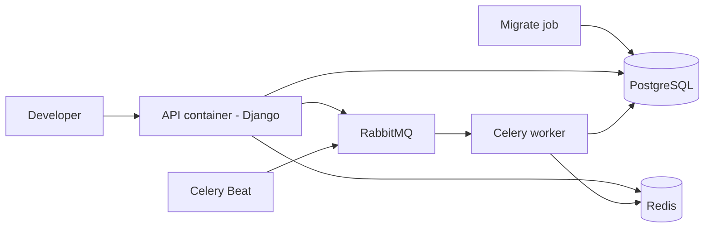

# Agrokredit Infra

> Containerized development environment for the Agrokredit loan-origination platform: database, cache, message broker, API and background workers started with one command.

-FC6D26?style=flat-square&logo=gitlab)

## Overview
Infrastructure repository for Agrokredit. It currently provides the local Docker environment for
[agrokredit-api](../agrokredit-api/), keeping a clean split of ownership: this repo owns service definitions and
environment examples, while the API repo owns application code and Python dependencies. Production deployment is a
separate, later stage.

## Key Features
- One-command startup of the full backend stack with health checks and service dependencies
- One-shot migration job that prepares a shared Python virtualenv and applies database migrations before the app starts
- Separate containers for the API, Celery worker and Celery Beat scheduler
- API source bind-mounted for live reload without rebuilding images
- Persistent named volumes for database, broker state, virtualenv and package cache; cache intentionally ephemeral
- Only the API and database published, and only on loopback; broker and cache are internal to the Docker network
- Required secrets enforced at startup (compose fails fast instead of using empty values)
- Documented operational commands: logs, management commands, Celery smoke test and worker health checks

## Architecture

Containers communicate by service name on a private network. Planned next steps for this repository include
production deployment with a reverse proxy and TLS, CI/CD, monitoring and connection pooling.

## Tech Stack
| Layer | Technologies |
| --- | --- |
| Orchestration | Docker Compose v2 |
| Services | PostgreSQL 17, Redis 7, RabbitMQ 4.3, Python 3.13 (Django, Celery) |

## My Role
Infrastructure setup: container topology, service health checks, volumes and environment configuration, developer
workflow documentation.

## 🔒 Source Code Access
The source code of this project is kept in a **private GitLab repository** (client / commercial project).
It is not published here. On request, I can walk through the codebase, architecture and live demo
in a **separate video call** for discussion.
