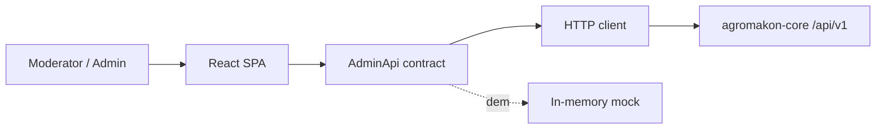

# Agromakon Admin

> Back-office panel for Agromakon moderators and administrators: seller and product moderation, orders, deposits, users and stores.

-FC6D26?style=flat-square&logo=gitlab)

## Overview
The internal staff panel of the Agromakon marketplace. Only users with the MODERATOR or ADMIN role can sign in; buyers
and sellers are rejected immediately after authentication. It is a single-page application on top of the
[agromakon-core](../agromakon-core/) admin and moderation APIs, complementing the public
[agromakon-web](../agromakon-web/) storefront.

## Key Features
- **Dashboard**: queue counters (new seller applications, products awaiting moderation), today's orders and totals,
  active/verified stores and a recent-activity feed
- **Seller application moderation** in a split view: queue, application details, uploaded documents, history,
  approve / reject with reason
- **Product moderation**: gallery, price, classification codes, variants and attributes; approve, reject or unpublish
- **Orders**: global order table with filters and a side detail panel; staff cancellation with reason
- **Deposits**: track seller sale deposits by payment ID / contract number, confirm receipt, refund or withhold
  (admin-only rate settings)
- **Users & staff**: search, edit contact data, block/unblock (including bulk), soft delete with a moderator-request /
  admin-approval flow, pre-create accounts, assign staff roles
- **Stores**: deactivate/activate with reason, "verified store" badge (admin only)
- **Role-based UI** mirroring backend permissions; keyboard-driven moderation (next/previous, approve, reject) and a
  global command search
- Filters, selection and opened items persisted in the URL for shareable links
- **Mock mode**: a full in-memory demo backend (lazy-loaded) so the panel can be shown without the API

## Architecture
Typed API layer with a single `AdminApi` contract and two implementations — HTTP (against the core) and mock — selected
at build time. All server state goes through TanStack Query hooks; routes are lazy-loaded and protected by role guards.

## Tech Stack
| Layer | Technologies |
| --- | --- |
| UI | React 19, TypeScript 5.9, Tailwind CSS 4, shadcn/ui (Radix), lucide-react, sonner |
| Routing / data | React Router 7 (data router), TanStack Query 5, TanStack Table |
| Forms | react-hook-form, zod |
| Build / tooling | Vite 8, ESLint 9, npm |

## My Role
Frontend development: panel architecture, API contract and data layer, moderation and admin workflows, role-based
access in the UI, and the mock demo mode.

## 🔒 Source Code Access
The source code of this project is kept in a **private GitLab repository** (client / commercial project).
It is not published here. On request, I can walk through the codebase, architecture and live demo
in a **separate video call** for discussion.
