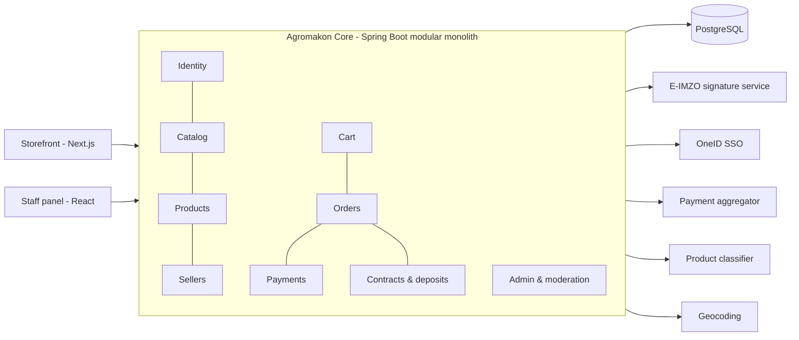

# Agromakon Core

> Backend for Agromakon, an agricultural marketplace for Agrobank where farmers, entrepreneurs and companies sell agro products and equipment to buyers across Uzbekistan.

-FC6D26?style=flat-square&logo=gitlab)

## Overview
Agromakon (agromakon.uz) is a B2C/B2B agro marketplace run by Agrobank's Mahallabay department. This repository is
the core REST API: it powers the public storefront ([agromakon-web](../agromakon-web/)) and the staff panel
([agromakon-admin](../agromakon-admin/)). It covers the full commerce cycle — catalog, seller onboarding,
product moderation, cart, checkout, payments, sale contracts signed with a digital signature, and back-office tools.

## Key Features
- **Passwordless sign-in** via E-IMZO (national digital signature, PKCS#7 challenge/verify) and OneID (government SSO);
  one account per citizen ID regardless of the login method. Server-side sessions with hashed tokens, HttpOnly cookies,
  Origin-based CSRF protection and rate-limited login attempts.
- **Catalog API** with full-text search, faceted filters (price, category, region, store, delivery, rating),
  "recommended" sorting by the buyer's preferred region, similar products and featured/verified stores.
- **Seller onboarding**: legal entities, individual entrepreneurs and self-employed sellers submit an application with
  documents, the application is signed with E-IMZO and goes to a moderation queue; approval creates a store and
  grants the seller role. Company names are resolved by taxpayer ID.
- **Product lifecycle & moderation**: draft → pending → published / rejected → archived, with image uploads, variants,
  stock and pricing, and mandatory national product classification codes (MXIK/IKPU) for fiscal receipts.
- **Cart, favorites and checkout**: multi-store checkout that splits into one order per store, delivery or pickup per
  store, idempotent order creation, atomic stock decrement and price/stock re-validation with conflict responses.
- **Payments**: online payment through a payment aggregator (cards and popular local wallets) with signed, idempotent
  callbacks; bank transfer with seller confirmation; and cash on receipt.
- **Sale contracts & deposits**: each accepted order generates a sale contract signed by both seller and buyer with
  E-IMZO, plus a seller deposit (platform commission) workflow with confirmation, refund and withholding.
- **Staff/admin API**: dashboard metrics, activity feed, order management, user blocking and soft deletion with an
  approval flow, staff role management, store verification/deactivation, "what's new" counters, and an audit trail of
  administrator actions.
- **Map-based delivery address**: reverse geocoding and address search backed by OpenStreetMap with caching.
- **Bilingual API** (Uzbek / Russian) driven by `Accept-Language`, including localized error messages and reference data.

## Architecture
A **modular monolith** built with Spring Modulith: each business area (taxonomy, sellers, products, catalog, identity,
cart, orders, payments, admin, …) is a separate module with enforced boundaries, verified by automated modularity tests.
A shared kernel holds API conventions (paging envelope, unified error format with trace IDs) and technical configuration.
The database schema evolves only through Flyway migrations, with Hibernate in validate-only mode.

Environment profiles (local / dev / stage / prod / test) control logging format (JSON in stage/prod), API docs
exposure and integration modes; external integrations (E-IMZO, OneID, payments, classifier, geocoding) all have fake
modes so the system can run and be tested offline.

## Tech Stack
| Layer | Technologies |
| --- | --- |
| Language / framework | Java 17, Spring Boot 4, Spring Web, Spring Security, Spring Data JPA, Bean Validation |
| Architecture | Spring Modulith (module boundaries, domain events) |
| Database | PostgreSQL (managed, serverless), Flyway migrations |
| API docs | springdoc-openapi (Swagger UI) |
| Integrations | E-IMZO, OneID, payment aggregator, MXIK classifier, OpenStreetMap Nominatim |
| Testing | JUnit, Testcontainers (PostgreSQL), modularity and i18n message tests |
| Tooling | Maven, Lombok, Spring Boot Actuator, Docker Compose (local DB) |

## My Role
Backend architecture and implementation: domain modelling, REST API design, authentication and digital-signature
integration, payments, order/contract workflows, database migrations and automated tests.

## 🔒 Source Code Access
The source code of this project is kept in a **private GitLab repository** (client / commercial project).
It is not published here. On request, I can walk through the codebase, architecture and live demo
in a **separate video call** for discussion.
