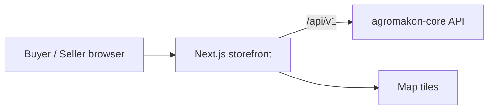

# Agromakon Web

> Public storefront of Agromakon, Agrobank's agricultural marketplace, where buyers browse agro products and sellers manage their stores.

-FC6D26?style=flat-square&logo=gitlab)

## Overview
The customer-facing web application of Agromakon (agromakon.uz). Buyers search the catalog, add products to the cart
and place orders; sellers apply to open a store and manage it from the same site. All data and business rules come
from the [agromakon-core](../agromakon-core/) API; staff work happens in [agromakon-admin](../agromakon-admin/).

## Key Features
- Home page with catalog highlights, featured and verified stores
- Product listing and product detail pages with filters, variants and similar products
- Store pages for each seller
- Cart and favorites tied to the signed-in account
- Multi-store checkout with delivery or pickup per store and a dedicated online payment step
- Order history and order details, including the sale-contract signing step
- Map-based delivery address picker (Leaflet)
- Buyer profile and sign-in with national digital signature (E-IMZO) or government SSO (OneID)
- Seller area: store application wizard and seller dashboard
- SEO basics: Open Graph image generation, robots rules, canonical URLs; terms and privacy pages; loading and error states

## Architecture
A Next.js App Router application (server and client components) that talks to the core API under `/api/v1` using a
session cookie shared across the site and API subdomains. A demo script can expose a local build through a temporary
secure tunnel so stakeholders can review the product without a server.

## Tech Stack
| Layer | Technologies |
| --- | --- |
| Framework | Next.js 16 (App Router), React 19 |
| Language | TypeScript 5 |
| Styling | Tailwind CSS 4, lucide-react icons, custom brand font |
| Maps | Leaflet |
| Tooling | ESLint 9, npm |

## My Role
Frontend development: page architecture, integration with the core API, authentication flows, checkout and seller
screens, and demo tooling.

## 🔒 Source Code Access
The source code of this project is kept in a **private GitLab repository** (client / commercial project).
It is not published here. On request, I can walk through the codebase, architecture and live demo
in a **separate video call** for discussion.
