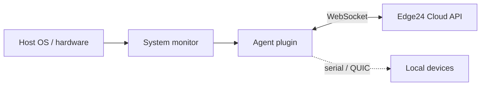

# Edge24 Agent

> Lightweight on-device agent for Edge24 edge appliances: reports host health to the cloud and executes control commands.

-FC6D26?style=flat-square&logo=gitlab)

## Overview
The agent is the **data-plane** component of Edge24. It runs on each edge device (single-board computer inside the
Edge24 box), opens an authenticated WebSocket connection to the [Edge24 Cloud API](../edge24-cloud-api/), and streams
device statistics while receiving commands such as configuration updates. The project is in an early stage of development.

## Key Features
- Persistent, authenticated WebSocket client connection to the cloud control plane
- System monitor collecting host info (OS, kernel, architecture, uptime, load averages)
- CPU usage, RAM / swap, process count
- Disk capacity, inode usage and per-second disk read/write rates
- Per-second network RX/TX throughput
- Command protocol for edge updates and statistics reporting
- Experimental QUIC server (lsquic) and serial-port support for attached hardware

## Architecture

## Tech Stack
| Layer | Technologies |
|---|---|
| Language | C++20 |
| Framework | Drogon (plugins, WebSocket client) |
| Transport | WebSocket, QUIC (lsquic), OpenSSL |
| Hardware I/O | libserialport |
| Build / Delivery | CMake, Docker, GitLab CI |

## My Role
Member of the Edge24 product team (platform context and integration with the web console that displays agent statistics).

## 🔒 Source Code Access
The source code of this project is kept in a **private GitLab repository** (client / commercial project).
It is not published here. On request, I can walk through the codebase, architecture and live demo
in a **separate video call** for discussion.
