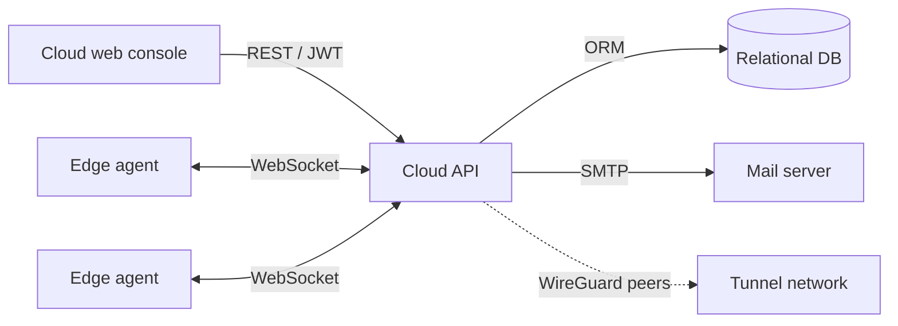

# Edge24 Cloud API

> Control-plane backend of the Edge24 EdgeOps platform: manages a fleet of edge devices, their tunnels and containerized services from one place.

-FC6D26?style=flat-square&logo=gitlab)

## Overview
Edge24 is a three-layer edge computing product (cloud control plane, on-device agent, edge hardware).
This repository is the **cloud control plane**: a high-performance C++ server that exposes a REST API for the
web console ([edge24-cloud-ui](../edge24-cloud-ui/)) and keeps a persistent WebSocket channel to every device agent
([edge24-agent-api](../edge24-agent-api/)). It is the successor of the earlier ioEdge backend ([ioedge-api-v1](../../ioedge/ioedge-api-v1/)).

## Key Features
- Account management with registration, login and email one-time-password (OTP) verification
- Role-based access: users can be granted roles on specific edges
- Edge device CRUD and lifecycle (create, update, delete, remote reboot)
- Live edge statistics (CPU, memory, disk, network) pushed by agents over WebSocket
- Secure tunnel management per edge, with per-tunnel status and statistics
- Container / service management on edge devices (start, stop, restart, update)
- Offline-tolerant design: changes are applied when an edge reconnects
- Automatic WireGuard peer provisioning during the edge lifecycle
- JWT-protected HTTP API with request filters; SMTP mail plugin for notifications

## Architecture
The server is organised in the Drogon style: HTTP controllers (Account, Role, Edge, Tunnel, Container), a WebSocket
controller for agents, ORM models, request filters and long-lived plugins (edge session registry, OTP, SMTP).

## Tech Stack
| Layer | Technologies |
|---|---|
| Language | C++20 |
| Framework | Drogon (HTTP, WebSocket, ORM, plugins) |
| Auth | JWT (jwt-cpp), email OTP |
| Networking | WebSocket, WireGuard, libcurl |
| Build | CMake |
| Delivery | Docker, GitLab CI |

## My Role
**Full-Stack Developer** — API development and the web console that consumes it; aligned the API contract with the earlier ioEdge backend and panel I built.

## 🔒 Source Code Access
The source code of this project is kept in a **private GitLab repository** (client / commercial project).
It is not published here. On request, I can walk through the codebase, architecture and live demo
in a **separate video call** for discussion.
