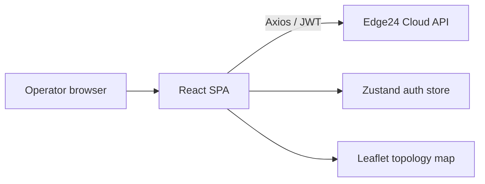

# Edge24 Cloud Console

> Web console for operating an Edge24 device fleet: topology map, live device stats, tunnels, containers and agent onboarding.

-FC6D26?style=flat-square&logo=gitlab)

## Overview
The single-page web application of the Edge24 platform. Operators sign in, see their edge devices on a map/topology
view, inspect real-time health, and manage tunnels and containerized services. It talks to the
[Edge24 Cloud API](../edge24-cloud-api/) and evolved from the earlier [ioEdge panel](../../ioedge/ioedge-ui-v1/).

## Key Features
- Sign-up and login with email OTP verification
- Geographic topology map of edges (Leaflet) with status pulse indicators and "last seen" labels
- Edge selector with hierarchical (tree) navigation
- Edge statistics panel with charts (CPU, memory, disk, network)
- Remote edge reboot
- Tunnel management panel
- Container / service management panel
- Agent registration panel guiding installation of the device agent
- Account and role management, light/dark theme

## Architecture

## Tech Stack
| Layer | Technologies |
|---|---|
| UI | React 19, TypeScript, shadcn/ui, Radix UI, Tailwind CSS 4 |
| State / data | Zustand, Axios, polling hooks |
| Visualisation | Leaflet / React-Leaflet, Recharts, React Flow, xterm |
| Tooling | Vite 7, ESLint, Prettier, pnpm |
| Delivery | Docker, docker-compose, GitLab CI |

## My Role
**Full-Stack Developer** — the console builds on the ioEdge panel codebase I started (layout, auth flow, edge tree, map view), connected to the Edge24 cloud API.

## 🔒 Source Code Access
The source code of this project is kept in a **private GitLab repository** (client / commercial project).
It is not published here. On request, I can walk through the codebase, architecture and live demo
in a **separate video call** for discussion.
