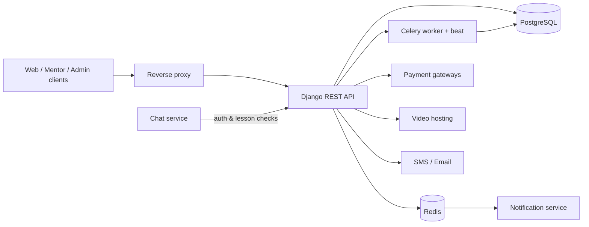

# Edu NeoSoft API

> Core backend of the NeoSoft online education platform: courses, enrollments, mentor contracts, payments and notifications for students and mentors in Uzbekistan.

-FC6D26?style=flat-square&logo=gitlab)

## Overview
Edu NeoSoft is an online learning platform (edu.neosoft.uz) where mentors publish video courses and students buy, watch and complete them. This repository is the main Django REST API: it owns users and roles, course content, orders and payment-gateway callbacks, mentor contracts and revenue sharing, and creates the notifications that are pushed to clients. It works together with the Go [chat service](../edu-neosoft-chat-service/) and [notification service](../edu-neosoft-notification-service/), and serves the [student web app](../edu-neosoft-ui/) and the [mentor dashboard](../edu-neosoft-mentor-ui/).

## Key Features
- Custom user model with three roles (student, mentor, manager), JWT auth with refresh tokens, Google OAuth, email verification and OTP flows
- Course catalogue with hierarchical categories, levels, prerequisites, ratings/reviews and bilingual (Uzbek / Russian) content
- Lessons with secure video playback through VdoCipher, downloadable resources and multiple-choice quizzes
- Enrollment and per-lesson progress tracking with completion percentage and completion certificates
- Orders and transactions with four local payment gateways: Payme, Click, Uzum and Multicard
- Automatic revenue split between the platform and mentors, with mentor balances maintained via Django signals
- Mentor onboarding with a lesson-approval workflow and automatically generated PDF contracts (WeasyPrint)
- Discount engine: promo codes and holiday discounts applied to orders
- Notification system (expiring, read/unread) published to Redis Streams for real-time delivery, plus email and SMS (Eskiz) channels
- Celery workers and Celery Beat for background and periodic jobs (e.g. cleaning expired notifications), monitored with Flower
- Swagger / ReDoc API documentation (drf-yasg)

## Architecture
The API is split into Django apps by domain (authentication, content, payment, discount, notification, emails, sms) with shared permissions, filters, validators and signals. Heavy work runs asynchronously in Celery; Redis is used both as cache/broker and as the event bus to the notification service.

## Tech Stack
| Layer | Technologies |
|---|---|
| Language / framework | Python 3.12, Django 5.2, Django REST Framework, SimpleJWT |
| Data | PostgreSQL 16, Redis 7 (cache, broker, streams) |
| Async | Celery, django-celery-beat, Flower |
| Auth | django-allauth, social-auth (Google OAuth) |
| Integrations | Payme, Click, Uzum, Multicard, VdoCipher, Eskiz SMS |
| Documents | WeasyPrint (PDF contracts), Pillow |
| API docs | drf-yasg (Swagger / ReDoc) |
| Delivery | Docker, Docker Compose, Gunicorn, GitLab CI/CD |

## My Role
Backend development: domain modelling, REST API design, payment-gateway integrations, background tasks, inter-service integration with the Go microservices, containerisation and CI/CD deployment.

## 🔒 Source Code Access
The source code of this project is kept in a **private GitLab repository** (client / commercial project).
It is not published here. On request, I can walk through the codebase, architecture and live demo
in a **separate video call** for discussion.
