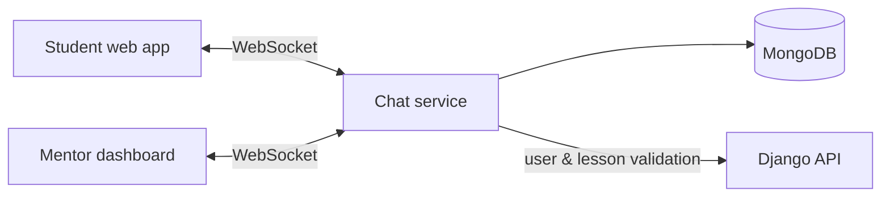

# Edu NeoSoft Chat Service

> Real-time mentor-student messaging microservice for the NeoSoft education platform, with one private conversation per lesson.

-FC6D26?style=flat-square&logo=gitlab)

## Overview
Students on the platform can ask the course mentor questions directly inside a lesson. This Go service handles that chat: it keeps WebSocket connections, routes messages between the mentor and the student, and stores the history in MongoDB. Identity and access are not duplicated here: the service validates users and lessons against the [Django API](../edu-neosoft-api/). It is used by the [student web app](../edu-neosoft-ui/) and the [mentor dashboard](../edu-neosoft-mentor-ui/).

## Key Features
- JWT-authenticated WebSocket connections, verified through the main Django backend
- Role-aware access: a mentor can talk to many students, a student only sees their own conversation
- Conversations bound to a lesson (lesson + mentor + student), with duplicates prevented by a unique index
- Instant message delivery with typing indicators and read receipts
- Per-conversation rooms managed by an in-memory WebSocket hub
- REST endpoints for listing conversations, conversation details, message history and online presence
- Persistent chat history in MongoDB
- Containerised build and GitLab CI pipeline

## Architecture
A small modular Go service: `auth` (Django integration), `db` (MongoDB repositories), `http` (REST handlers) and `ws` (hub, clients, events).

## Tech Stack
| Layer | Technologies |
|---|---|
| Language | Go 1.23 (net/http) |
| Real-time | Gorilla WebSocket |
| Storage | MongoDB (official Go driver) |
| Integration | Django REST API (auth, lessons) |
| Delivery | Docker, Docker Compose, GitLab CI/CD |

## My Role
Design and implementation of the service: WebSocket hub and event protocol, MongoDB data model, integration with the Django backend, containerisation and deployment.

## 🔒 Source Code Access
The source code of this project is kept in a **private GitLab repository** (client / commercial project).
It is not published here. On request, I can walk through the codebase, architecture and live demo
in a **separate video call** for discussion.
