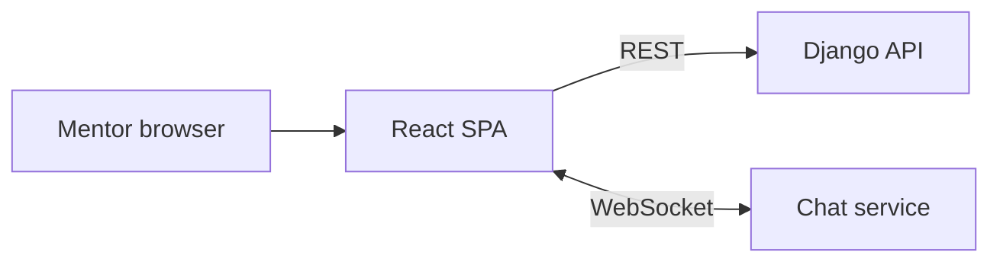

# Edu NeoSoft Mentor UI

> Dashboard for mentors on the NeoSoft education platform to create courses, upload lessons, follow their students and answer chat messages.

-FC6D26?style=flat-square&logo=gitlab)

## Overview
Mentors are the content creators of Edu NeoSoft. This single-page application is their workspace: they build courses step by step, add lessons, see enrolled students and reports, and reply to students in real time. It talks to the [Django API](../edu-neosoft-api/) and the [chat service](../edu-neosoft-chat-service/), complementing the student-facing [web app](../edu-neosoft-ui/).

## Key Features
- Mentor login with protected / public route guards
- Overview dashboard with charts (Recharts)
- "My courses": multi-step course creation wizard (category, details) with a rich-text description editor
- Course page with lesson grid and a drawer for adding and uploading lessons
- Students list and reports pages
- Real-time chat with students: conversation list, message view and locally saved drafts
- Profile and settings pages
- Uzbek / Russian localisation with automatic language detection; light/dark theme switcher
- Reusable data table, breadcrumbs and lazy-loaded, config-driven routing

## Architecture
Vite + React SPA organised by pages, with shared components, hooks and stores. Server state is handled by TanStack Query over an Axios client; small UI state lives in Zustand. Ant Design provides the component library, themed together with Tailwind CSS.

## Tech Stack
| Layer | Technologies |
|---|---|
| Framework | React 19, TypeScript, Vite 7 (SWC) |
| UI | Ant Design 5, Tailwind CSS 4, Lucide icons, SweetAlert2 |
| Data / state | TanStack Query, Axios, Zustand, Immer |
| Routing | React Router 7 |
| i18n | i18next, react-i18next |
| Charts | Recharts |
| Tooling | ESLint, Husky, Vercel config for hosting |

## My Role
Frontend development of the mentor workspace and its integration with the backend and chat service.

## 🔒 Source Code Access
The source code of this project is kept in a **private GitLab repository** (client / commercial project).
It is not published here. On request, I can walk through the codebase, architecture and live demo
in a **separate video call** for discussion.
