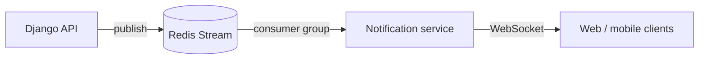

# Edu NeoSoft Notification Service

> Event-driven Go microservice that pushes platform notifications (promotions, course events, system messages) to online users in real time.

-FC6D26?style=flat-square&logo=gitlab)

## Overview
The [Django API](../edu-neosoft-api/) creates notifications and stores them in its database; instead of calling this service directly it publishes each one to a Redis Stream. This Go service consumes the stream and forwards each notification over WebSocket to the specific user, so the [student web app](../edu-neosoft-ui/) can show it instantly. Decoupling through Redis keeps notifications durable if the service restarts.

## Key Features
- Redis Streams consumer using consumer groups for ordered, durable delivery
- Per-user WebSocket sessions managed by a central hub
- Targeted push: each event is delivered only to the user it belongs to
- Structured notification payloads (type, title, message, metadata, action link)
- Health endpoint for monitoring
- Horizontally scalable: additional instances can join the same consumer group
- Small, shell-less distroless production image

## Architecture

## Tech Stack
| Layer | Technologies |
|---|---|
| Language | Go 1.23 |
| Messaging | Redis 7 Streams (consumer groups) |
| Real-time | WebSocket |
| Delivery | Multi-stage Docker build (distroless), Docker Compose, GitLab CI/CD |

## My Role
Architecture and implementation of the event pipeline between Django and clients, Go WebSocket service, containerisation and deployment.

## 🔒 Source Code Access
The source code of this project is kept in a **private GitLab repository** (client / commercial project).
It is not published here. On request, I can walk through the codebase, architecture and live demo
in a **separate video call** for discussion.
