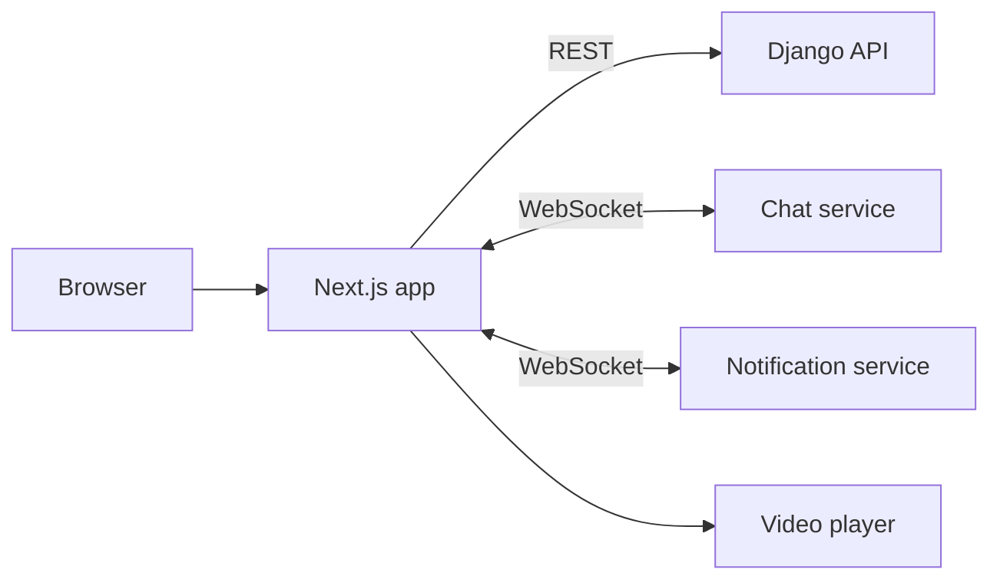

# Edu NeoSoft UI

> Student-facing web application of the NeoSoft education platform: browse and buy courses, watch lessons, chat with mentors and track progress, in Uzbek and Russian.

-FC6D26?style=flat-square&logo=gitlab)

## Overview
This is the public website and learner area of Edu NeoSoft (edu.neosoft.uz). Visitors explore the course catalogue, register and pay through local payment providers; enrolled students watch protected video lessons and talk to their mentor in real time. The app consumes the [Django API](../edu-neosoft-api/) and connects over WebSocket to the [chat](../edu-neosoft-chat-service/) and [notification](../edu-neosoft-notification-service/) services.

## Key Features
- Course catalogue with search, pagination and filters (price, level, category, instructor, rating, discounts)
- Course detail pages and a lesson "watch" view with secure VdoCipher video playback and downloadable resources
- Registration and login with OTP account activation and JWT auth with automatic token refresh
- Checkout via Payme, Click and Uzum
- In-lesson real-time chat with the mentor
- Real-time notifications over WebSocket with auto-reconnect and toast messages
- "Become a mentor" application flow with document submission and OTP-confirmed contract signing
- Student dashboard sections for courses, payments, certificates and profile
- Full Uzbek / Russian localisation with locale-based routing; static pages (about, privacy, terms)
- Responsive, animated UI (Tailwind CSS 4, Framer Motion, Swiper)

## Architecture
Next.js App Router with a `[locale]` segment and route groups for the public site and the student dashboard. API access is wrapped in typed service modules (auth, content, payment, mentor, chat) on top of Axios; client state lives in Zustand stores.

## Tech Stack
| Layer | Technologies |
|---|---|
| Framework | Next.js 16 (App Router), React 19, TypeScript |
| Styling / UI | Tailwind CSS 4, Framer Motion, Lucide icons, Swiper |
| State / data | Zustand, Axios |
| i18n | next-intl (Uzbek, Russian) |
| Utilities | date-fns, react-day-picker, react-hot-toast |
| Delivery | Docker, Docker Compose, GitLab CI/CD |

## My Role
Frontend development and integration with the backend and real-time services; containerised deployment.

## 🔒 Source Code Access
The source code of this project is kept in a **private GitLab repository** (client / commercial project).
It is not published here. On request, I can walk through the codebase, architecture and live demo
in a **separate video call** for discussion.
