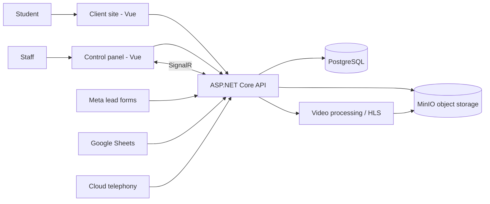

# HeroAcademy

> Learning platform plus CRM for a language and test-prep academy (SAT, IELTS, General English): online courses with protected video, tests, and a sales and operations back office.

-FC6D26?style=flat-square&logo=gitlab)

## Overview
HeroAcademy combines two things an education business usually buys separately: a student-facing learning site (courses, video lessons, tests, enrollment) and an internal control panel for managing leads, students, groups, schedules and content. The repository is a monorepo with an ASP.NET Core Web API, a Vue control panel for staff and a Vue client site for students.

## Key Features
- **Online courses** with course catalogue, bundles, enrollment requests, "my courses" and student profiles; Google sign-in on the client site.
- **Protected video streaming**: uploaded videos are processed in the background into HLS playlists with AES encryption; decryption keys are released only to students actively enrolled in the course (admins get preview access).
- **Testing engine**: test categories, test bundles and a question bank, with math-formula authoring (MathLive / KaTeX) and rich-text editing.
- **CRM**: leads, a configurable sales pipeline, tasks, custom fields, triggers/automation and a CRM dashboard.
- **Lead capture integrations**: Meta (Facebook/Instagram) lead forms via webhook and Google Sheets sync.
- **Telephony integration** with a cloud PBX via webhook, with real-time call notifications pushed to the panel over SignalR.
- **Academic operations**: student groups with study directions (SAT, IELTS, General English), lesson schedule calendar with teacher/room conflict detection, group and student reports, data export.
- **Site content management** for the public client site; role management, JWT authentication, rate limiting and centralized error handling.
- Structured logging shipped to Grafana Loki; Swagger API documentation; multilingual UI (vue-i18n) and guided UI tours.

## Architecture
Layered .NET solution: **API** (controllers, SignalR hub, middleware) → **Business** (services) → **Data** (EF Core) → **Core** (domain), with a separate **Video** infrastructure project for media processing. Files and video segments are stored in S3-compatible object storage.

## Tech Stack
| Layer | Technologies |
|---|---|
| Backend | .NET 8, ASP.NET Core Web API, Entity Framework Core, SignalR, JWT, AspNetCoreRateLimit, Swashbuckle |
| Logging | Serilog, Grafana Loki |
| Data / storage | PostgreSQL, MinIO (S3-compatible) |
| Media | Background HLS transcoding with AES-128 encryption |
| Control panel | Vue 3, TypeScript, Vite, Pinia, Tailwind CSS 4, Headless UI, vue-quill, MathLive, KaTeX, hls.js, v-calendar |
| Client site | Vue 3, Vite, axios, hls.js, KaTeX, vue-i18n |
| Ops | Docker Compose, GitLab CI |

## My Role
Full-stack development and delivery: backend modules and integrations, control panel features, local/production setup and deployment.

## 🔒 Source Code Access
The source code of this project is kept in a **private GitLab repository** (client / commercial project).
It is not published here. On request, I can walk through the codebase, architecture and live demo
in a **separate video call** for discussion.
