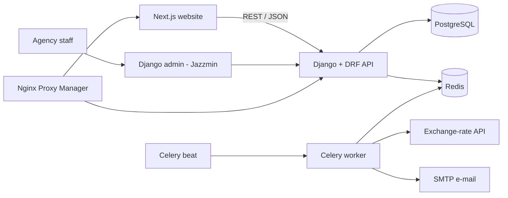

# IMZA API

> Backend and admin panel for IMZA, a Dubai real-estate agency platform: property and off-plan project listings, agent profiles, branded PDF brochures and a searchable property-transactions database.

-FC6D26?style=flat-square&logo=gitlab)

## Overview
IMZA is a real-estate agency operating in the UAE (Dubai). This repository is the REST API and the
content-management back office behind the public website ([imza-ui](../imza-ui/)). Agency staff manage
areas, developers, off-plan projects, ready properties and agent profiles in a bilingual (English / Russian)
admin panel, while the website consumes the data through a public JSON API. It also hosts a large
property-transactions dataset with full-text search intended for agents' market research, which is the
foundation for the planned IMZA CRM (in setup).

## Key Features
- **Listings catalogue** – areas, developers, off-plan projects and properties with images, videos, brochures,
  floor plans, payment plans, travel times and amenity features; SEO-friendly slugs.
- **Multilingual content** – translatable models (English / Russian) via django-parler, rich-text
  descriptions, language-aware API responses.
- **Filtering and pagination** – django-filter based filters for properties, projects, developers and areas;
  limit/offset pagination; camelCase JSON for the frontend.
- **Multi-currency pricing** – a scheduled Celery task fetches AED exchange rates and caches converted
  property prices in Redis.
- **PDF brochures** – on-demand, branded property PDF generation (ReportLab) with photos, key details,
  amenity icons and the responsible agent's contact card, in the requested language and currency.
- **Agents / team** – custom e-mail based user model with roles (admin, agent), area specialization,
  languages and a public team listing for the website.
- **Property transactions search** – a dedicated dataset of market transactions with PostgreSQL full-text
  search (search vector + GIN indexes, pg_trgm trigram indexes), multi-field filters, price/size ranges and
  a metadata endpoint for building filter UIs.
- **Data import** – CSV / Excel import into the admin (django-import-export plus a custom import screen) with
  value normalization.
- **Website forms** – contact / enquiry form endpoints whose notifications are sent by e-mail asynchronously
  through Celery.
- **Admin panel** – Jazzmin-themed Django admin with inline editors and role-based permissions;
  Swagger / OpenAPI docs via drf-yasg.

## Architecture

The API, Celery worker and Celery beat run from the same Docker image built by GitLab CI and pushed to the
GitLab container registry. Docker Compose orchestrates PostgreSQL, Redis, the API (Gunicorn), Celery, the
Next.js frontend and an Nginx reverse proxy with Let's Encrypt certificates.

## Tech Stack
| Layer | Technologies |
|---|---|
| Language / framework | Python, Django 5.1, Django REST Framework |
| Data | PostgreSQL 15 (full-text search, pg_trgm), Redis |
| Background jobs | Celery, django-celery-beat |
| Content & i18n | django-parler, CKEditor, django-import-export, VersatileImageField |
| Documents | ReportLab, svglib, openpyxl |
| API tooling | drf-yasg (Swagger), django-filter, djangorestframework-camel-case, SimpleJWT, CORS headers |
| Admin UI | Django admin with Jazzmin theme |
| Quality | pytest, pytest-django, factory_boy, coverage, black, isort |
| DevOps | Docker, Docker Compose, Gunicorn, Nginx Proxy Manager, GitLab CI/CD, GitLab Container Registry |

## My Role
Backend development: data modelling, REST API design, admin panel customization, PDF generation,
full-text search for the transactions dataset, Celery tasks, containerization and CI/CD deployment.
Active development during 2025.

## 🔒 Source Code Access
The source code of this project is kept in a **private GitLab repository** (client / commercial project).
It is not published here. On request, I can walk through the codebase, architecture and live demo
in a **separate video call** for discussion.
