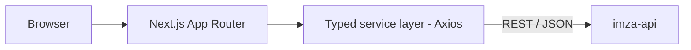

# IMZA Website (UI)

> Public marketing website for IMZA, a Dubai real-estate agency, showcasing services, areas, featured properties and the agent team.

-FC6D26?style=flat-square&logo=gitlab)

## Overview
This repository is the customer-facing website of IMZA (imza.ae). It presents the agency, its services and
the areas it covers, displays featured properties and the agent team, and collects enquiries through a
contact form. All dynamic content comes from the Django REST backend in [imza-api](../imza-api/), which is
also where staff manage listings and team profiles.

## Key Features
- Home page with hero banner, introduction and entry points into the main sections
- Area page with description and property cards loaded from the API
- Services page listing the agency's services
- Team page with director and employee cards, a carousel, and per-agent detail pages (dynamic routes)
- Contact page with an enquiry form integrated with the backend, plus contact info and social links
- Legal pages: privacy policy, terms, cookies
- Typed API layer (Axios instance + service classes) for properties and public team profiles
- Responsive layout with shared navbar / footer and Framer Motion animations

## Architecture

Built with the Next.js App Router; pages compose section components (Home, Area, Services, Team, Contact),
and data access is isolated in a small service layer. The app is packaged as a Docker image by GitLab CI and
deployed alongside the API behind a reverse proxy.

## Tech Stack
| Layer | Technologies |
|---|---|
| Framework | Next.js 16 (App Router), React 19, TypeScript |
| Styling / UI | Tailwind CSS 4, Framer Motion, lucide-react, react-icons |
| Data | Axios |
| Tooling | ESLint, Yarn |
| DevOps | Docker, GitLab CI/CD |

## My Role
Frontend development and API integration (October to December 2025), containerization and deployment.

## 🔒 Source Code Access
The source code of this project is kept in a **private GitLab repository** (client / commercial project).
It is not published here. On request, I can walk through the codebase, architecture and live demo
in a **separate video call** for discussion.
