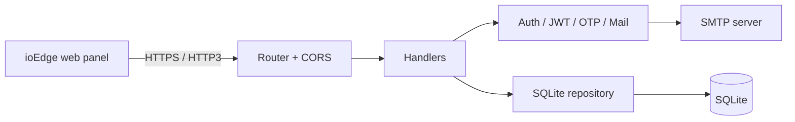

# ioEdge API (v1)

> Go backend for the ioEdge panel: accounts, a hierarchical tree of edge devices, role-based access and Docker service definitions.

-FC6D26?style=flat-square&logo=gitlab)

## Overview
ioEdge is an edge-computing management product. This repository is the first version of its backend: a dependency-light
Go service that serves the [ioEdge web panel](../ioedge-ui-v1/) over HTTPS (HTTP/2) and HTTP/3. Its concepts
(accounts, edges, roles, services) were later carried over to the [Edge24 Cloud API](../../edge24/edge24-cloud-api/).

## Key Features
- Account registration, login and password setup via email one-time passwords (SMTP)
- JWT bearer-token authentication with configurable TTL
- Hierarchical edge tree management (create, read, update, delete)
- Role assignment on edges by email, auto-creating accounts for invited users
- Service definitions per edge: Docker image, private registry credentials, ports, environment, volumes, commands
- TLS server with HTTP/2 and HTTP/3 (QUIC), plus a helper tool to verify the HTTP/3 handshake
- SQLite storage with app-level schema migration and bootstrap of the root edge
- Configurable CORS, health and version endpoints; Postman collection for the API

## Architecture
Clean layered layout: `cmd` entrypoints, `internal/config`, `internal/http` (router, handlers, server),
`internal/repository/sqlite`, and `internal/service` (auth, JWT, mail, OTP).

## Tech Stack
| Layer | Technologies |
|---|---|
| Language | Go (standard `net/http`) |
| Transport | TLS, HTTP/2, HTTP/3 (quic-go) |
| Storage | SQLite (pure-Go driver) |
| Auth | JWT (golang-jwt), email OTP |
| Delivery | Docker, docker-compose, GitLab CI |

## My Role
Backend development: project structure, API design, authentication/OTP flow, edge and service modules, HTTP/3 server setup.

## 🔒 Source Code Access
The source code of this project is kept in a **private GitLab repository** (client / commercial project).
It is not published here. On request, I can walk through the codebase, architecture and live demo
in a **separate video call** for discussion.
