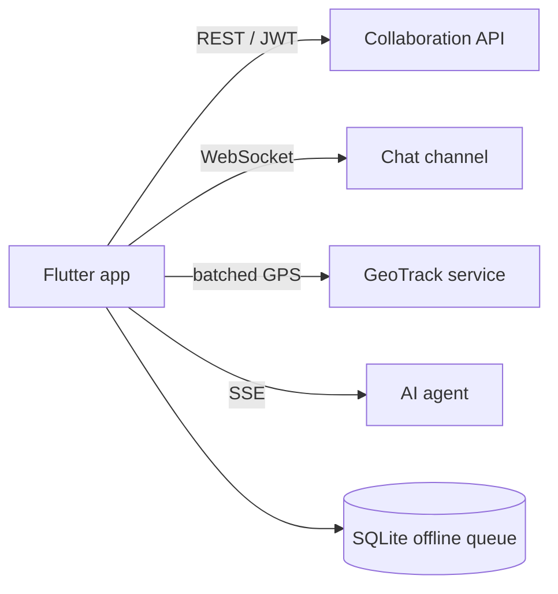

# AgroMahalla Mobile

> Flutter app for Agrobank's mahalla bankers and field staff: neighbourhood visits, credit products and plans, credit-monitoring acts, chat, training and an AI credit assistant – with offline support and background GPS tracking.

-FC6D26?style=flat-square&logo=gitlab)

## Overview
The field-facing client of the Mahallabay collaboration platform. Bankers assigned to mahallas use it to plan and
record visits, work through citizen registers, fill in credit-monitoring acts with signatures and photos, track
their credit plan, and stay in touch with the head office. It authenticates against the
[Collaboration API](../collaboration-api/), streams location data to [GeoTrack](../geotrack/) with the same token,
and embeds the [AI agent](../ai-agent/) credit assistant.

## Key Features
- **Login with OTP verification**, secure token storage and role-aware navigation (field staff, leadership, developer).
- **Visits**: visit list, topical visit forms, and an order-based citizen register with per-citizen cards and visit
  history; visit location capture with photos.
- **Banker workspace**: assigned mahallas, clients and contacts, tasks, notepad and reminders with in-app alarms.
- **Credits**: credit product catalogue with details, monthly credit plan vs. actuals, targeted-credit list and a
  monitoring act form with an on-screen signature pad.
- **AI assistant tab** streaming answers from the AI agent, with local chat history.
- **Chat** with real-time updates over WebSocket and message previews.
- **Training**: lessons and tests for staff.
- **Background geo-tracking**: policy check, permission explainer, device registration and session, GPS points queued
  in SQLite and sent in idempotent batches when online; visible foreground notification on Android.
- **Offline mode**: connectivity monitoring, local store and sync of pending actions.
- **Developer tab** showing server status, container list and alerts for on-call monitoring.
- **Localization** (Uzbek and Russian) with a custom brand theme and font.

## Architecture

The code is organised into `core` (API client, config, offline sync, roles, storage), `features` (data layers per
domain) and `screens` (UI per tab), with a shared widget kit and theme.

## Tech Stack
| Layer | Technologies |
|-------|--------------|
| Framework | Flutter, Dart 3, Material |
| Networking | http, web_socket_channel |
| Storage | flutter_secure_storage, shared_preferences, sqflite |
| Device | geolocator, flutter_background_service, image_picker, file_picker, battery_plus, device_info_plus, connectivity_plus |
| UI | webview_flutter, flutter_native_splash, intl, custom design system |
| Platforms | Android, iOS |

## My Role
Mobile development and backend integration: app architecture, API and real-time integrations, offline queueing and
background tracking, together with the server-side endpoints the app relies on.

## 🔒 Source Code Access
The source code of this project is kept in a **private GitLab repository** (client / commercial project).
It is not published here. On request, I can walk through the codebase, architecture and live demo
in a **separate video call** for discussion.
