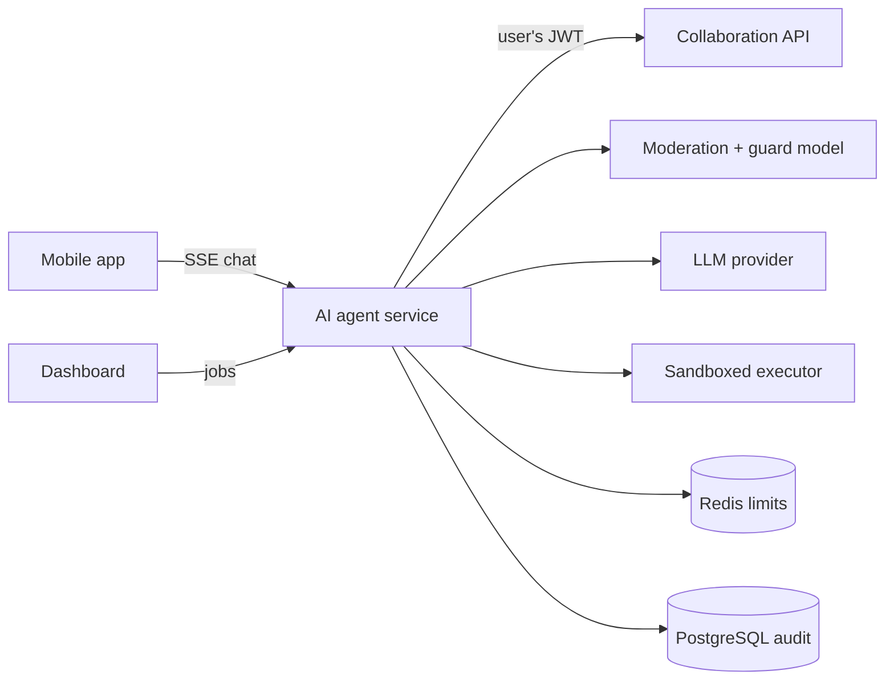

# AI Agent

> Guarded AI services for the Mahallabay platform: a credit assistant chat for mahalla bankers in the mobile app, and a sandboxed "Excel agent" that processes office documents for head-office staff.

-FC6D26?style=flat-square&logo=gitlab)

## Overview
A standalone FastAPI service next to the [Collaboration API](../collaboration-api/). It has two parts:
1. **"Agro AI" credit assistant** – the AI tab of the [mobile app](../agro-mahalla-mobile/). It answers bankers'
   questions strictly about the bank's credit catalogue, the banker's own credit plan and the status of their
   credit-monitoring acts, and refuses everything else.
2. **Excel agent** – the "AI Agent" page of the [dashboard](../collaboration-dashboard/). Staff upload Excel/CSV,
   Word or PDF files with an instruction and receive an answer, a formula or a generated `.xlsx` / `.docx` / `.pdf`.

The service reuses the platform's JWTs and calls existing read-only API endpoints with the user's own token,
so data access rules stay in the core backend.

## Key Features
- **Streaming chat over SSE** with typed events (status, text deltas, replacements, block notices, completion).
- **Layered safety**: data allow-listing before anything reaches the model, PII masking of user input and output,
  moderation scoring, a small "guard" model with a strict JSON schema that rejects off-topic or prompt-injection
  requests before the main model, and a constrained system prompt.
- **Tool calling**: the model fetches the banker's credit plan and targeted-credit data through backend tools instead
  of guessing.
- **Abuse handling** with two-step confirmation and time-limited blocks, plus per-day and per-minute rate limits.
- **Language detection** from script (Uzbek Latin / Uzbek Cyrillic / Russian) to answer in the user's language.
- **Audit trail** of requests, outcomes, tools and token usage with masked questions (answers are not stored).
- **Excel agent with sandboxed execution**: the LLM only sees the file structure and masked sample rows and writes
  Python; code runs on the full file in an isolated, network-less executor container (read-only FS, resource limits,
  AST checks, timeouts).
- **Document conversion** inside the sandbox: Office ↔ PDF via LibreOffice, PDF tables to Excel, PDF to Word with OCR
  fallback (Tesseract) for scanned documents.
- **Demo mode** with a fake LLM provider for end-to-end testing without API keys; pytest suite including PII-leak tests.

## Architecture

## Tech Stack
| Layer | Technologies |
|-------|--------------|
| Service | Python 3.11, FastAPI, Uvicorn, Pydantic, httpx |
| AI | OpenAI API (chat, moderation), Anthropic Claude API (Excel agent) |
| Auth | PyJWT (shared platform tokens) |
| Storage | Redis (rate limits), PostgreSQL via asyncpg (audit, jobs) |
| Sandbox | Separate Docker container, LibreOffice, pdfplumber, pdf2docx, Tesseract OCR, openpyxl, python-docx |
| Quality & delivery | pytest, Docker, GitLab CI/CD |

## My Role
Design and implementation of the service: LLM integration, safety layers, tool calling, streaming protocol,
sandboxed executor and tests.

## 🔒 Source Code Access
The source code of this project is kept in a **private GitLab repository** (client / commercial project).
It is not published here. On request, I can walk through the codebase, architecture and live demo
in a **separate video call** for discussion.
