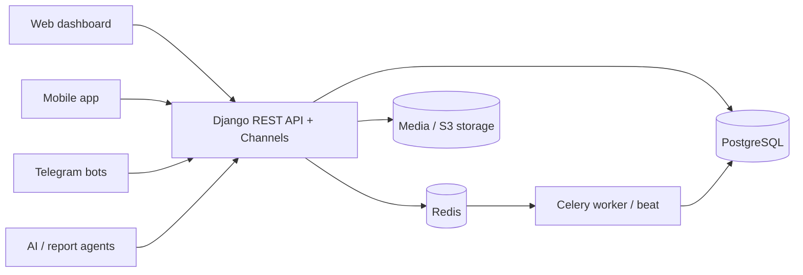

# Collaboration API

> Central REST backend of Agrobank's "Mahallabay" collaboration platform: project and task management for head-office staff, plus field-work, region and credit-monitoring data for neighbourhood ("mahalla") bankers.

-FC6D26?style=flat-square&logo=gitlab)

## Overview
The Mahallabay department of Agrobank coordinates work between the head office, regional branches and
bankers assigned to individual neighbourhoods (mahallas). This repository is the platform's core backend:
a Django REST API that the [web dashboard](../collaboration-dashboard/), the [mobile app](../agro-mahalla-mobile/),
the Telegram bots ([main bot](../mahallabay-main-bot/), [monitoring bot](../monitoring-telegram-bot/)) and the
AI services ([ai-agent](../ai-agent/), [report-agent](../report-agent/)) all talk to. It started as an internal
project/task tracker and grew into the system of record for field visits, credit products and regional reporting.

## Key Features
- **Authentication & access control** – login by personal ID number and password with JWT access/refresh tokens;
  a granular permission catalogue with position-based defaults, manual grants and a separate RBAC module.
- **Organisation structure** – strict department → division → section hierarchy, plus a region → branch → mahalla
  catalogue with cascading selectors used across all clients.
- **Projects & tasks** – projects with members, archive/restore and progress tracking; tasks with subtasks,
  comments, approval, and Kanban views by status or assignee with drag-and-drop moves.
- **Field visits ("tashrif")** – a unified visit model for all work directions: configurable directions that can be
  switched on/off, target levels, area rules, evidence requirements (photos, video, GPS accuracy) and history snapshots.
- **Low-code form constructor ("konstruktor")** – admin-defined directions with form schemas, conditions, formulas,
  workflows, plans, Excel import/export, summary ("svod") reports and a dedicated mobile API.
- **Citizen registers** – an order-based register of citizens who could not be employed (Excel import, one card per
  citizen, visit history, generated act documents), and income-growth / employment records.
- **Credit product catalogue** – credit products with conditions, feeding the mobile app's credit screen, banker credit
  plans and targeted-credit monitoring acts.
- **Communication** – in-app notifications, a real-time chat (Django Channels over WebSockets), personal reminders
  with alarms and recurring schedules, and Telegram delivery.
- **Reports & documents** – dashboard and employee/project/deadline reports with Excel export; Word/PDF generation
  from templates; training materials; full audit log of important actions.
- **Integrations & docs** – a separate integration API namespace, OpenAPI schema via drf-spectacular for an in-app
  "API & integrations" page, and a Postman collection.
- **Background jobs** – Celery Beat schedules for deadline and overdue checks, nightly progress recalculation and
  weekly summary notifications.

## Architecture

The code is split into Django apps per domain (auth, users, departments, regions, projects, tasks, files, tashrif,
konstruktor, buyurtma, credits, employment, training, chat, notifications, reminders, reports, audit, integration, rbac).
The Docker image runs migrations and seeds the permission catalogue and org units on start; GitLab CI builds and deploys it.

## Tech Stack
| Layer | Technologies |
|-------|--------------|
| Framework | Python 3.11, Django 4.2, Django REST Framework, Simple JWT |
| Real-time | Django Channels, channels-redis, Daphne / Uvicorn |
| Data | PostgreSQL (psycopg 3), Redis cache (django-redis) |
| Background jobs | Celery, django-celery-beat |
| Documents | openpyxl, python-docx, docxtpl, fpdf2, mammoth |
| Storage | Local media or S3-compatible storage (django-storages, boto3) |
| API docs & admin | drf-spectacular (OpenAPI), django-jazzmin admin, Postman |
| Delivery | Docker, Gunicorn, GitLab CI/CD |

## My Role
Backend development and technical lead on the API: domain modelling, REST API design, permissions, background jobs,
integrations with the mobile app, bots and AI services, code review/merging and Docker-based deployment.

## 🔒 Source Code Access
The source code of this project is kept in a **private GitLab repository** (client / commercial project).
It is not published here. On request, I can walk through the codebase, architecture and live demo
in a **separate video call** for discussion.
