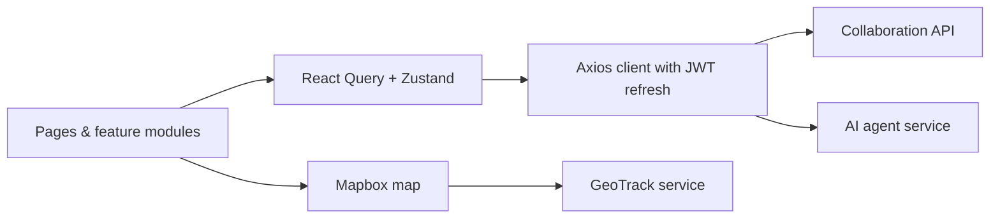

# Collaboration Dashboard

> Web dashboard of Agrobank's "Mahallabay" collaboration platform, used by department leadership, head-office staff and branches to manage projects, tasks, field work and regional reporting.

-FC6D26?style=flat-square&logo=gitlab)

## Overview
A single-page application on top of the [Collaboration API](../collaboration-api/). Directors, managers and
specialists of the Mahallabay department use it to run projects and tasks, while the same app gives
supervisors views over regions, branches, mahallas, field visits, credit monitoring and employee locations
(via [GeoTrack](../geotrack/)). It also hosts the web UI for the [AI agent](../ai-agent/) and a Telegram Mini App
page used from the [main bot](../mahallabay-main-bot/). Menus and routes are driven by the permissions returned by the API.

## Key Features
- **Dashboard** with overall statistics, project status, employee workload and upcoming deadlines.
- **Projects and tasks**: tables, Kanban boards by status or assignee with drag-and-drop, task drawers, "my tasks".
- **Field work**: region / district / branch / mahalla pages, visit monitoring, act ("dalolatnoma") review, and a
  low-code **Konstruktor** for defining directions and forms that the mobile app renders.
- **Geo-tracking** map of employee locations built on Mapbox GL.
- **Credits, employment and training** modules for the bank's mahalla programmes.
- **Files & documents**: upload and in-browser preview of PDF, Excel and Word files; rich-text editing (Tiptap) and
  spreadsheet editing (Univer); Excel/PDF export (ExcelJS, jsPDF).
- **Chat, notifications and reminders**, including a background alarm host that pops up due reminders with sound.
- **AI Agent page** for uploading Excel/Word/PDF files and getting processed results or formulas.
- **Permission-based navigation**: sidebar items and routes are guarded by permission codenames; JWT with automatic
  token refresh on 401.

## Architecture

Code is organised into pages, feature modules, shared components and service layers. Production builds are
static files served by Nginx inside a Docker image, built and deployed by GitLab CI.

## Tech Stack
| Layer | Technologies |
|-------|--------------|
| UI | React 19, TypeScript, Ant Design 5, Tailwind CSS 4, Lucide icons |
| Build & tooling | Vite, ESLint, Vitest, pnpm |
| Routing & state | React Router 7, TanStack React Query 5, Zustand |
| Forms & validation | React Hook Form, Zod |
| Interaction | dnd-kit (drag & drop), Tiptap editor, Univer sheets, Mapbox GL |
| Documents | ExcelJS, jsPDF, mammoth |
| Delivery | Docker, Nginx, GitLab CI/CD |

## My Role
Frontend development and integration with the backend: page and module implementation, permission-based
navigation, API integration and deployment pipeline, as part of the overall platform work.

## 🔒 Source Code Access
The source code of this project is kept in a **private GitLab repository** (client / commercial project).
It is not published here. On request, I can walk through the codebase, architecture and live demo
in a **separate video call** for discussion.
