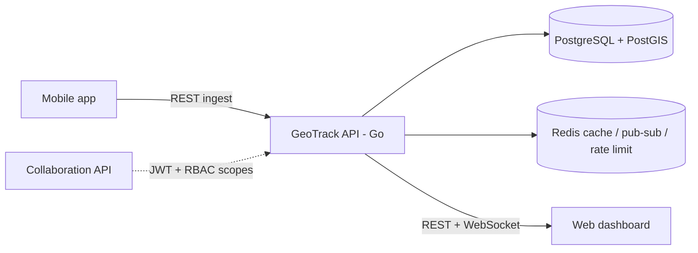

# Mahallabay GeoTrack

> Go microservice for real-time location tracking of field staff: ingests GPS points from the mobile app, stores route history in PostGIS and streams live positions to the web dashboard.

-FC6D26?style=flat-square&logo=gitlab)

## Overview
Mahalla bankers spend much of their day visiting neighbourhoods. GeoTrack is a separate Go service of the
Mahallabay collaboration platform that records where field staff are, with permission-aware access for supervisors.
It reuses users, JWT authentication and RBAC organisational scopes from the [Collaboration API](../collaboration-api/)
(tokens are verified independently), keeps all of its own tables in a dedicated schema without hard foreign keys
to the core database, receives points from the [mobile app](../agro-mahalla-mobile/) and serves the map in the
[dashboard](../collaboration-dashboard/). The service is complete for local testing and load-testing; production
rollout is gated by a pre-release checklist.

## Key Features
- **Tracking policies** per user or role, with an enabled-by-default setting that explicit policies can override.
- **Devices and tracking sessions** with start/end lifecycle.
- **Single and batch location ingest** with client-generated event IDs for idempotent replay of offline queues.
- **Suspicious point detection** (mock location, poor accuracy, impossible speed or jumps) – points are kept for audit
  but flagged with reasons.
- **Live view** via a Redis-backed current-location snapshot, plus a **WebSocket** stream with Redis pub/sub fan-out.
- **History** of routes, stops and daily aggregates, with geofences and geofence events.
- **Access auditing**: every permission-sensitive history view is logged; coordinates are never written to logs.
- **Data lifecycle**: month-partitioned point tables with automatic partition creation and a 365-day retention sweep.
- **Rate limiting**, health/readiness probes and an OpenAPI contract.

## Architecture

Packages are split into API handlers, auth, domain, tracking logic, repository, realtime and observability layers.
SQL migrations ship inside the Docker image and run through a dedicated migrate service; GIST and BRIN indexes back
spatial and time-range queries.

## Tech Stack
| Layer | Technologies |
|-------|--------------|
| Service | Go 1.24, net/http, gorilla/websocket, golang-jwt |
| Data | PostgreSQL 16 + PostGIS 3.5 (pgx), partitioned tables, golang-migrate |
| Realtime & caching | Redis 7 (go-redis): live snapshot, pub/sub, rate limiting |
| API contract | OpenAPI 3 |
| Testing | Go unit tests, PostGIS/Redis integration tests, k6 load tests |
| Delivery | Docker, GitLab CI/CD |

## My Role
Service design and implementation: data model and migrations, ingest and live-tracking APIs, WebSocket streaming,
security and retention design, tests and load testing.

## 🔒 Source Code Access
The source code of this project is kept in a **private GitLab repository** (client / commercial project).
It is not published here. On request, I can walk through the codebase, architecture and live demo
in a **separate video call** for discussion.
