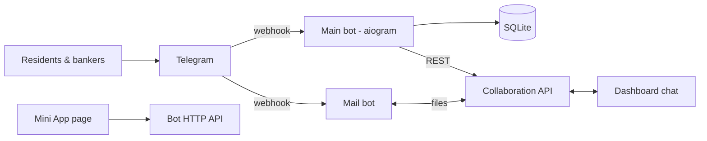

# Mahallabay Main Bot

> Telegram bot connecting residents with their neighbourhood ("mahalla") bankers at Agrobank – credit information and applications for clients, and a field-work cabinet for bankers – plus a companion bot that relays files between the web dashboard chat and staff on Telegram.

-FC6D26?style=flat-square&logo=gitlab)

## Overview
The public-facing Telegram entry point of the Mahallabay collaboration platform. A resident can find the banker
responsible for their mahalla, browse credit products and leave an application or contact request; a banker who
logs in through the same bot gets a menu for their daily field work. The bot talks to the
[Collaboration API](../collaboration-api/) for staff identity, credit products and visit data, and serves a small
HTTP API for a Telegram Mini App page hosted in the [dashboard](../collaboration-dashboard/). A second, independent
"mail" bot runs in the same process and bridges the dashboard chat with employees' Telegram accounts.

## Key Features
- **Onboarding and language selection** (Uzbek / Russian), phone-number sharing and client registration.
- **Banker lookup**: residents find their mahalla banker by region and mahalla, with contact details.
- **Credit products**: catalogue browsing with formatted conditions and deep-link "apply" flows that route a client's
  application to the right banker.
- **Client requests and appeals**: contact requests, appeals to leadership and links to official social channels.
- **Banker cabinet**: banker identification by phone against platform staff records, monitoring menu, topical-visit
  and targeted-credit forms, and the citizen-register ("buyurtma") workflow.
- **Mini App API**: a client-profile endpoint authenticated with Telegram init data.
- **Access control**: middleware that blocks restricted clients; append-only client records enforced at database level.
- **Data import**: Excel import of the banker directory and mahalla codes (pandas / openpyxl).
- **File relay bot ("pochta")**: sends documents from the dashboard chat to staff on Telegram and forwards files staff
  send back into the chat; supports large files through a local Bot API server.
- **Webhook deployment** with health check, tests, Docker image and GitLab CI.

## Architecture

Both bots share one aiohttp web server and container, each with its own token, dispatcher and webhook path.

## Tech Stack
| Layer | Technologies |
|-------|--------------|
| Bot framework | Python, aiogram 3 (FSM, routers, middleware) |
| Web server | aiohttp (webhooks, Mini App API, internal endpoints) |
| Storage | SQLite, aiofiles |
| Data import | pandas, openpyxl |
| Integrations | Collaboration API (REST), Telegram Bot API / local Bot API server |
| Delivery | Docker, GitLab CI/CD |

## My Role
Bot design and development: conversation flows, integration with the platform API, file relay between the dashboard
and Telegram, data import and deployment.

## 🔒 Source Code Access
The source code of this project is kept in a **private GitLab repository** (client / commercial project).
It is not published here. On request, I can walk through the codebase, architecture and live demo
in a **separate video call** for discussion.
