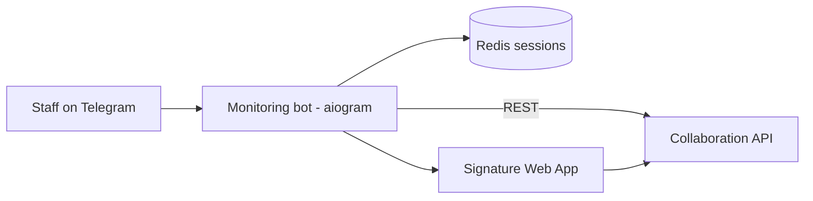

# Monitoring Telegram Bot

> Telegram bot for Agrobank Mahallabay staff to submit field-monitoring reports from mahallas – location, assessment and photos – and to fill in low-income family survey forms with an e-signature step.

-FC6D26?style=flat-square&logo=gitlab)

## Overview
A lightweight data-collection channel of the Mahallabay collaboration platform for staff who work from Telegram
rather than the [mobile app](../agro-mahalla-mobile/). Employees log in with their phone number, which is verified
against staff records in the [Collaboration API](../collaboration-api/); depending on their permissions they get a
menu for regional monitoring visits and/or the low-income family survey. All submitted data goes straight to the
API, where it appears in the [dashboard](../collaboration-dashboard/).

## Key Features
- **Phone-based login** with ownership check of the shared contact and permission-based menus.
- **Persistent sessions** stored in Redis, with restore on `/start`, logout and cancel at any step.
- **Monitoring visit flow**: cascading region → district → mahalla selection with paging, live location capture,
  suitability assessment, optional multi-photo upload and a confirmation summary before submission.
- **Low-income family survey**: guided multi-step questionnaire (family selection, status, yes/no questions, visit
  date validation, photos).
- **E-signature via Telegram Web App**: a signing page opens inside Telegram, linked to a short-lived signing session.
- **Active-user middleware** that re-checks access on each update.
- **Docker image** and GitLab CI deployment.

## Architecture

## Tech Stack
| Layer | Technologies |
|-------|--------------|
| Bot framework | Python, aiogram 3 (FSM, routers, middleware, inline keyboards) |
| Web | aiohttp, Telegram Web App (HTML signing page) |
| Session storage | Redis |
| Integrations | Collaboration API (REST) |
| Delivery | Docker, GitLab CI/CD |

## My Role
Bot development and integration with the platform API: conversation flows, session handling, signing web app and
deployment.

## 🔒 Source Code Access
The source code of this project is kept in a **private GitLab repository** (client / commercial project).
It is not published here. On request, I can walk through the codebase, architecture and live demo
in a **separate video call** for discussion.
