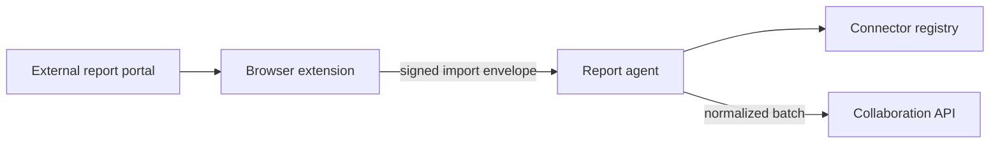

# Report Agent

> Secure ingestion gateway that receives report data captured by the AgroMahalla browser extension from external portals, validates it and forwards normalized snapshots to the platform backend.

-FC6D26?style=flat-square&logo=gitlab)

## Overview
Part of the Mahallabay collaboration platform. Some of the figures the department tracks (for example, micro-project
reports per mahalla on the public "Online Mahalla" portal) are only available as exports in third-party web systems.
A browser extension collects these exports, and this small FastAPI service sits between the extension and the
[Collaboration API](../collaboration-api/): it authenticates the import, validates and normalizes the payload through
a pluggable connector, cross-checks totals and only then hands the data to the backend. The service is a compact,
well-tested scaffold with one production connector so far.

## Key Features
- **Import envelope pipeline**: short-lived per-connector import tokens, strict schema validation, payload size limit
  and SHA-256 hash verification of a canonical JSON form.
- **Connector registry**: each source is a connector with its own schema, enable flag and normalization logic;
  unknown, disabled or unimplemented connectors are rejected with distinct status codes and nothing is stored.
- **First connector – micro-project reports**: parses report rows, keeps only the columns needed for calculations
  (no personal data), uses exact decimal money handling and records which mahallas were checked.
- **Control-sum reconciliation**: totals are recalculated per mahalla and project type and must exactly match the
  control block sent from the source, otherwise the import is refused.
- **Point-in-time restores** with an "as of" date that must be consistent with the payload.
- **Idempotent forwarding** to the backend, which creates import batches and snapshots.
- **Privacy-aware logging** with request IDs – only metadata is logged, never payloads.

## Architecture

## Tech Stack
| Layer | Technologies |
|-------|--------------|
| Service | Python 3.11, FastAPI, Uvicorn, Pydantic 2 |
| Security | PyJWT import tokens, payload hashing |
| HTTP client | httpx |
| Quality & delivery | pytest, Docker, GitLab CI/CD |

## My Role
Service design and backend development: import protocol, connector abstraction, validation and reconciliation
logic, tests and containerized deployment.

## 🔒 Source Code Access
The source code of this project is kept in a **private GitLab repository** (client / commercial project).
It is not published here. On request, I can walk through the codebase, architecture and live demo
in a **separate video call** for discussion.
