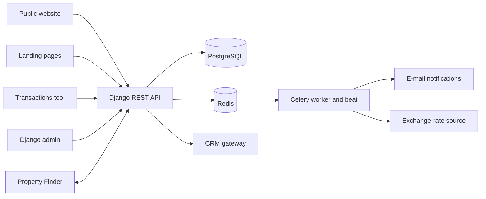

# MHP API

> REST backend for the Master Homes Properties platform: property listings, off-plan projects, agents, lead forms and a Dubai property-transactions database.

-FC6D26?style=flat-square&logo=gitlab)

## Overview
MHP API is the central backend of the Master Homes real-estate platform in Dubai. It serves the public
website ([mhp-ui](../mhp-ui/)), the off-plan project landing pages ([off-plan-ui](../off-plan-ui/)) and the internal
property-transactions tool ([mhp-crm](../mhp-crm/)). Content managers work in a customised Django admin, while
listings are kept in sync with the Property Finder portal (see also [pf-service](../pf-service/)).

## Key Features
- Catalogue API for **areas, developers, off-plan projects, properties and agents**, with filtering, pagination and slug-based detail pages
- **Multilingual content** (django-parler) for projects and properties, camelCase JSON output for the frontends
- **Property brochure PDF generation** (ReportLab) with amenity icons and branding
- **Property Finder integration**: API client, data converter, full sync command and a webhook receiver for listing updates
- **Lead forms** for the website and landing pages (contact, project inquiry, landing-page and subscription forms) with asynchronous e-mail notification through Celery
- **Property-transactions module**: large Excel uploads with automatic column mapping, PostgreSQL full-text search, range/meta endpoints (communities, projects, buildings, property types, bedrooms), CSV export and bulk operations
- **Multi-currency prices**: a scheduled Celery task fetches AED exchange rates and caches converted prices in Redis
- JWT authentication (SimpleJWT) for agent / staff endpoints; Swagger/OpenAPI docs via drf-yasg
- Admin customisation with Jazzmin, CKEditor 5, import/export and Select2 widgets
- Gateway scripts for CRM (Bitrix24) webhooks and Meta conversion events

## Architecture

## Tech Stack
| Layer | Technologies |
|-------|--------------|
| Language / framework | Python, Django 5.1, Django REST Framework |
| Data | PostgreSQL 15 (full-text search, triggers), Redis 7 |
| Background jobs | Celery, django-celery-beat |
| API tooling | SimpleJWT, django-filter, drf-yasg, djangorestframework-camel-case |
| Content | django-parler, CKEditor 5, versatileimagefield, Jazzmin admin, import-export |
| Documents | ReportLab, svglib, openpyxl |
| Quality | pytest, pytest-django, factory_boy, coverage, black, isort |
| Delivery | Docker, Docker Compose, Gunicorn, GitLab CI (image build and push) |

## My Role
**Full-Stack Developer** — API endpoints, integrations, background tasks and Docker-based deployment.

## 🔒 Source Code Access
The source code of this project is kept in a **private GitLab repository** (client / commercial project).
It is not published here. On request, I can walk through the codebase, architecture and live demo
in a **separate video call** for discussion.
