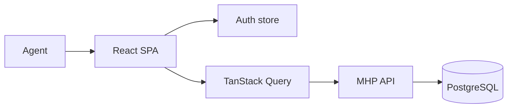

# MHP CRM (Property Transactions)

> Internal back-office tool for Master Homes agents to search, filter, edit and import Dubai property-transaction records.

-FC6D26?style=flat-square&logo=gitlab)

## Overview
A single-page admin application used by the sales team to work with a large database of property transactions
(sales history, units, buildings, communities and owner records). It is the frontend for the property-transactions
module of [mhp-api](../mhp-api/) and is used alongside the public website [mhp-ui](../mhp-ui/).

## Key Features
- JWT login with token storage and an authenticated HTTP client
- Dashboard shell with a collapsible sidebar, breadcrumbs and light/dark theme
- **All properties** table with cursor-based pagination for large datasets
- Rich filtering: free-text search, community, project, building, property type, bedrooms, date range, price and size ranges
- Dedicated **plots** view (land-only transactions)
- Inline editing of records and bulk delete
- **Excel import** with a report of mapped and unmatched columns, and **CSV export**
- Filter options loaded from API "meta" endpoints (communities, projects, buildings, types, bedrooms)

## Architecture
Feature-based structure (`features/auth`, `features/dashboard`, `features/properties`), each with its own API layer,
pages, store and types; shared HTTP client, JWT helpers and config live in `shared/`. UI is built from shadcn/ui
components on top of Radix / Base UI.

## Tech Stack
| Layer | Technologies |
|-------|--------------|
| Framework | React 19, TypeScript, Vite 7 |
| UI | Tailwind CSS 4, shadcn/ui, Radix UI, Base UI, lucide / Remix icons, react-day-picker |
| Data / state | Axios, TanStack Query, Zustand, date-fns |
| Tooling | ESLint, Prettier, pnpm |
| Delivery | Docker, GitLab CI |

## My Role
Frontend development within the team: data tables, filters, import/export flows and API integration.

## 🔒 Source Code Access
The source code of this project is kept in a **private GitLab repository** (client / commercial project).
It is not published here. On request, I can walk through the codebase, architecture and live demo
in a **separate video call** for discussion.
