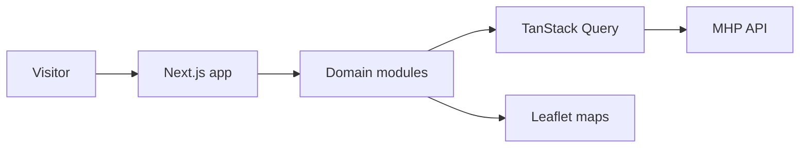

# MHP UI

> The public website of Master Homes Properties: a bilingual catalogue of Dubai properties and off-plan projects with search, maps and lead forms.

-FC6D26?style=flat-square&logo=gitlab)

## Overview
MHP UI is the customer-facing website of the Master Homes real-estate agency. Buyers and investors can browse ready
and off-plan properties, explore developer projects, contact agents and send inquiries. All data comes from
[mhp-api](../mhp-api/); this repository is the Next.js frontend only.

## Key Features
- Property catalogue with filters (type, price range slider, bedrooms, area) and paginated results
- Property detail pages: image gallery, overview, features, agent card, location map and inquiry form
- Off-plan **project** listing and detail pages driven by slugs from the API
- About us, Contact us, Construction (contracting services) and Privacy Policy pages
- Internationalisation with locale-prefixed routes (English and Russian) via next-intl
- Price display in multiple currencies and area unit conversion helpers
- Interactive maps with Leaflet / React-Leaflet
- Lead forms with international phone input and react-hook-form validation
- Server-state caching with TanStack Query; lightweight client state with Zustand

## Architecture
Modular structure: `app/` holds the App Router pages and i18n setup, `modules/` groups each domain (home, property,
project, about-us, contact-us, construction) with its own components (atoms / molecules / templates), API services,
hooks, store and types, and `shared/` contains common UI and utilities.

## Tech Stack
| Layer | Technologies |
|-------|--------------|
| Framework | Next.js 15 (App Router, Turbopack), React 19, TypeScript |
| Styling / UI | Tailwind CSS 4, Radix UI, Headless UI, Framer Motion, Swiper, lucide / react-icons |
| Data | Axios, TanStack Query, Zustand |
| Forms | react-hook-form, react-international-phone |
| i18n | next-intl |
| Maps | Leaflet, React-Leaflet |
| Delivery | Docker, GitLab CI |

## My Role
Frontend development within the team: pages, components, API integration and localisation.

## 🔒 Source Code Access
The source code of this project is kept in a **private GitLab repository** (client / commercial project).
It is not published here. On request, I can walk through the codebase, architecture and live demo
in a **separate video call** for discussion.
