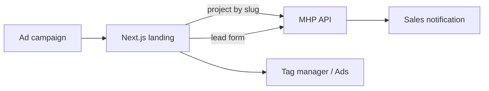

# Off-Plan Landing (off-plan-ui)

> Reusable, API-driven landing page template for promoting individual off-plan projects in Dubai and capturing buyer leads.

-FC6D26?style=flat-square&logo=gitlab)

## Overview
Earlier campaign pages ([damac-properties](../damac-properties/), [dubailand](../dubailand/),
[fairmont-downtown](../fairmont-downtown/), [dubai-island](../dubai-island/), [ramhan](../ramhan/)) were built as
separate static sites. This project replaces that approach with one Next.js template that loads a project by slug
from [mhp-api](../mhp-api/), so a new campaign page needs content in the admin rather than a new codebase.

## Key Features
- Project data (banner, info, gallery, highlights, amenities, floor plans, prices, location, agent) fetched from the API by slug
- Sections: hero slider, overview, highlights, amenities, floor plans, pricing, gallery, travel times, location map
- Interactive location map (Leaflet)
- Lead form with country picker and phone parsing to E.164, success modal and floating contact buttons
- Leads posted to the backend landing-form endpoint
- Marketing analytics: dataLayer events and Google Ads enhanced conversions
- Configurable theme and SEO metadata

## Architecture

## Tech Stack
| Layer | Technologies |
|-------|--------------|
| Framework | Next.js 16, React 19, TypeScript |
| UI | Tailwind CSS 4, Swiper, Heroicons, react-icons |
| Data | Axios |
| Maps | Leaflet, React-Leaflet |
| Delivery | Docker, Docker Compose, GitLab CI, pnpm |

## My Role
Frontend development within the team: landing page sections, API integration and lead form.

## 🔒 Source Code Access
The source code of this project is kept in a **private GitLab repository** (client / commercial project).
It is not published here. On request, I can walk through the codebase, architecture and live demo
in a **separate video call** for discussion.
