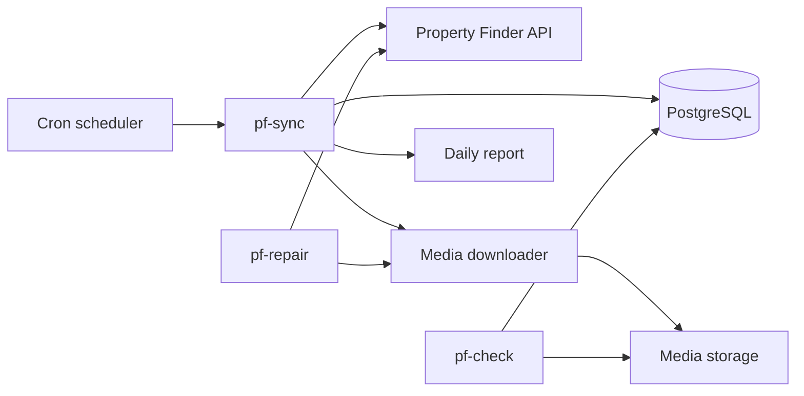

# PF Service (Property Finder Sync)

> Go microservice that synchronises property listings, agents and images from the Property Finder portal into the Master Homes database.

-FC6D26?style=flat-square&logo=gitlab)

## Overview
Master Homes publishes its listings on Property Finder, the leading UAE property portal. This service pulls those
listings and agent profiles through the Property Finder API and writes them into the same PostgreSQL schema used by
[mhp-api](../mhp-api/), so the company website ([mhp-ui](../mhp-ui/)) always shows current inventory. It moved the
heavy sync work out of the Django app into a dedicated Go binary.

## Key Features
- Authenticated (token-based) access to the Property Finder API with paginated listing fetches
- Create-or-update sync of **agents/users** and **properties**, including area mapping
- Image download with retries, back-off and timeouts; unique file names
- **Safety by design**: create/update only, no delete operations against the shared database
- Separate CLI tools: `pf-sync` (main sync), `pf-check` (find missing image files), `pf-repair` (re-download missing images)
- Daily statistics report (created/updated records, downloaded images, errors)
- Scheduled nightly run via cron inside the container
- Unit and integration tests for the downloader and sync safety

## Architecture

## Tech Stack
| Layer | Technologies |
|-------|--------------|
| Language | Go 1.23 |
| Data access | GORM, PostgreSQL driver (pgx) |
| HTTP | go-resty |
| Config | godotenv / environment variables |
| Delivery | Multi-stage Docker build (Alpine), cron, Docker Compose, GitLab CI |

## My Role
Backend development within the team: sync logic, image handling and containerised scheduling.

## 🔒 Source Code Access
The source code of this project is kept in a **private GitLab repository** (client / commercial project).
It is not published here. On request, I can walk through the codebase, architecture and live demo
in a **separate video call** for discussion.
