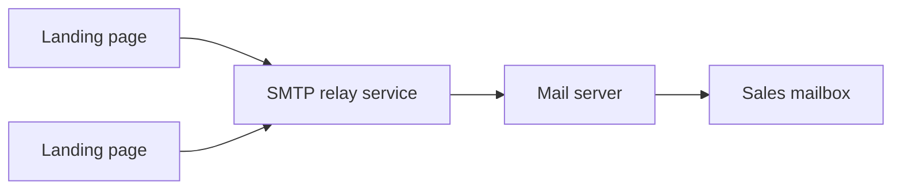

# SMTP Service

> Small e-mail relay microservice that lets static landing pages send lead notifications without exposing mail credentials in the browser.

-FC6D26?style=flat-square&logo=gitlab)

## Overview
The Master Homes campaign pages ([damac-properties](../damac-properties/), [dubailand](../dubailand/),
[fairmont-downtown](../fairmont-downtown/) and others) are static React builds with no backend of their own. This
service gives them a single HTTP endpoint for sending lead e-mails; SMTP settings are kept on the server side in
environment variables. It is intentionally minimal (one source file).

## Key Features
- One JSON `POST` endpoint that accepts sender, recipient, subject and text
- Validation of required fields with clear 400 responses
- SMTP delivery through Nodemailer, configured fully via environment variables (host, port, TLS, credentials)
- CORS enabled for browser-based landing pages
- Containerised with Docker and built by GitLab CI

## Architecture

## Tech Stack
| Layer | Technologies |
|-------|--------------|
| Runtime | Node.js, Express 4 |
| Mail | Nodemailer |
| Middleware | cors, body-parser |
| Delivery | Docker, GitLab CI |

## My Role
**Full-Stack Developer** — development and deployment of the relay service.

## 🔒 Source Code Access
The source code of this project is kept in a **private GitLab repository** (client / commercial project).
It is not published here. On request, I can walk through the codebase, architecture and live demo
in a **separate video call** for discussion.
