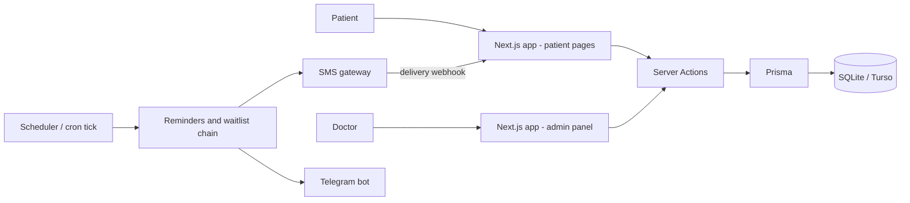

# MediaStom

> Dental clinic platform: online appointment booking, treatment history with a tooth chart, automated SMS reminders and a waitlist that fills cancelled slots automatically.

-FC6D26?style=flat-square&logo=gitlab)

## Overview
MediaStom is a full-stack web application for a dental clinic. Patients book visits with a chosen doctor from their phone, see their treatment history and respond to "come earlier?" offers; doctors and the chief doctor manage the schedule, patient cards, services and promotional content from an admin panel. It is a single Next.js application (App Router with Server Actions) with a mobile-first interface.

## Key Features
**For patients**
- Sign-up / login by phone number with an SMS one-time code; Telegram bot and Telegram Mini App as an alternative/fallback login channel.
- Online booking: choose doctor, date, free time slot, service and complaint.
- Treatment history with diagnosis, procedures, recommendations and per-tooth status on an FDI dental chart.
- Self-service cancellation, and earlier-slot offers with accept/decline and a countdown timer.
- Service catalogue with price, treatment duration, expected lifetime, number of visits and stages.
- Home-page video promos in a stories-style autoplay carousel.

**For doctors / admins**
- Today's queue, next patient and statistics; weekly appointment calendar filterable by doctor.
- Booking on behalf of patients who call in, and cancellation that triggers the waitlist chain.
- Patient card with a tooth chart and per-visit notes (diagnosis, procedures, teeth, recommendations).
- Management of services, doctors, working hours and lunch breaks, and promo videos (chief-doctor only).
- SMS log with template approval status, balance, test sending and delivery tracking.

**Automation**
- **Reminders**: an in-process scheduler sends an SMS a configurable number of hours before each appointment (once per appointment), or an immediate confirmation for late bookings.
- **Cancellation chain**: when a slot is freed, the same doctor's next patient that day is offered it; acceptance moves them forward and frees their own slot for the next offer, and declines or timeouts pass the offer on.
- **SMS gateway integration** using provider-approved templates, idempotency keys against duplicate sends, an HMAC-verified delivery webhook and status polling as a fallback.
- Serverless-friendly mode: the scheduler can be disabled and driven by an external cron endpoint instead.

## Architecture

Core domain: patients, doctors, services, appointments, slot offers, visits, tooth records, OTP codes and SMS logs. Times are handled explicitly in the Tashkent time zone.

## Tech Stack
| Layer | Technologies |
|---|---|
| Framework | Next.js 16 (App Router, Server Actions, route protection), React 19, TypeScript |
| Styling | Tailwind CSS 4, lucide-react |
| Data | Prisma 6, SQLite locally, Turso (libSQL) in production |
| Auth | Phone + OTP, JWT sessions (jose), Telegram Mini App login |
| Integrations | Uzbek SMS gateway (templates, webhooks), Telegram Bot API |
| Hosting | Vercel (with external cron) or a VPS with a long-running process |

## My Role
Full-stack development: product design, data model, booking and waitlist logic, SMS and Telegram integrations, admin panel and deployment.

## 🔒 Source Code Access
The source code of this project is kept in a **private GitLab repository** (client / commercial project).
It is not published here. On request, I can walk through the codebase, architecture and live demo
in a **separate video call** for discussion.
