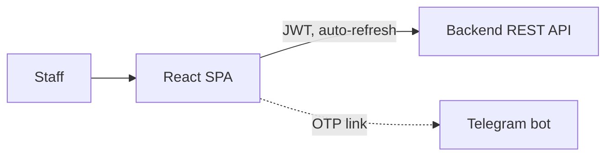

# Nazar Education — Administration Panel

> Staff-facing web panel for running an education center: leads, trial lessons, invoices, payments, cash desk and payroll.

-FC6D26?style=flat-square&logo=gitlab)

## Overview
The internal single-page application used by directors, administrators, sales managers and teachers of Nazar Education. It is the main client of the [backend API](../nedu-backend/); students and parents do not use it (they are served by the [Telegram bot](../nedu-telegram-bot/)). Teachers can also use the [mobile app](../nedu-mobile-app/).

## Key Features
- **Passwordless login** via phone number and a 6-digit code delivered in Telegram, with a guided flow when the account is not yet linked to the bot.
- **Role-aware navigation** for five staff roles; a single menu config drives both the sidebar and the routes, and each role lands on its own start page (KPI dashboard vs. "today's lessons").
- Three protection layers: authenticated route guard, per-section role check (403 page) and branch scoping.
- **CRM**: Kanban and list views of leads, comments, daily follow-up tasks, trial lessons and lead-to-student conversion.
- **Finance**: invoices, payments and a debtor list that all derive from one source, so a payment recorded anywhere is reflected everywhere.
- **Cash desk**: shift management, journal and balances; expense tracking; payroll sheets and a teacher's own salary view.
- Dashboard with KPI cards and charts (area, donut, funnel).
- Axios client with automatic JWT refresh that de-duplicates concurrent refresh requests.
- Uzbek-style money formatting implemented independently of browser locale quirks.

## Architecture

## Tech Stack
| Layer | Technologies |
|---|---|
| Build | Vite 6, TypeScript 5 |
| UI | React 18, Ant Design 5 (+ Pro Components), Recharts, Day.js |
| Routing / HTTP | React Router 6, axios |
| Ops | Docker image served by nginx, GitLab CI (typecheck, build, smoke test, deploy) |

## My Role
Front-end architecture and development, role/permission model on the client side, API integration with the backend, CI/CD.

## 🔒 Source Code Access
The source code of this project is kept in a **private GitLab repository** (client / commercial project).
It is not published here. On request, I can walk through the codebase, architecture and live demo
in a **separate video call** for discussion.
