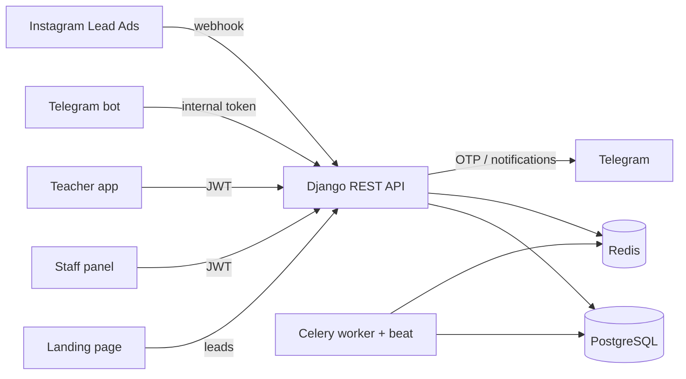

# Nazar Education — Backend (CRM + LMS + Finance)

> REST API that runs the day-to-day operations of an offline education center: lead pipeline, groups and schedules, invoicing, cash desk and teacher payroll.

-FC6D26?style=flat-square&logo=gitlab)

## Overview
Nazar Education is an offline tutoring center in Chirchiq, Uzbekistan (school subjects, national certificate prep, IELTS, kids courses). Leads used to be tracked in notebooks and spreadsheets, cash was hard to reconcile and teacher salaries were calculated by hand. This repository is the core backend of the center's internal system: a modular Django monolith exposing a versioned REST API consumed by the staff panel ([../nedu-administration/](../nedu-administration/)), the public landing page ([../nedu-website/](../nedu-website/)), the teacher mobile app ([../nedu-mobile-app/](../nedu-mobile-app/)) and the Telegram bot ([../nedu-telegram-bot/](../nedu-telegram-bot/)).

## Key Features
- **Phone-based authentication** with JWT and one-time codes delivered through Telegram (codes stored hashed, attempt limits enforced outside the rollback scope).
- **Multi-role access model**: one person can hold several roles (e.g. director + teacher); permissions are task-based and every queryset is scoped to the user's branch.
- **CRM pipeline**: lead sources, configurable funnel stages, activities, follow-up tasks and trial lessons; a public lead endpoint with throttling and de-duplication for the website form.
- **Instagram Lead Ads integration** via a Meta webhook that creates leads automatically.
- **Lead-to-student conversion** in a single transaction: user account, student profile, group enrollment and first invoice.
- **Academics**: groups, recurring weekly schedules, enrollments with clash detection, and Celery-generated lessons that skip holidays.
- **Finance**: automatic invoices (monthly prorated or per-module), promotions and personal concessions, payments by cash / card / bank transfer with reversal entries, debtor lists.
- **Cash desk**: shift opening/closing with discrepancy tracking, cash accounts whose balances are derived from movements, expenses, transfers and adjustments.
- **Payroll**: salary sheets based on actually collected revenue (percentage, fixed or KPI-based), with approval and payout steps.
- **Audit trail** on financial and CRM models, OpenAPI documentation and health/readiness endpoints.

## Architecture
A layered modular monolith: domain apps (`core`, `accounts`, `org`, `catalog`, `crm`, `academics`, `finance`, `integrations`) depend only on lower layers, business logic lives in service functions, and money-changing operations run inside atomic transactions with an append-only ledger.

## Tech Stack
| Layer | Technologies |
|---|---|
| Language / framework | Python 3.12, Django 5, Django REST Framework |
| Auth | SimpleJWT, phone-number login, Telegram OTP |
| Data | PostgreSQL 16, Redis 7, django-simple-history |
| Background jobs | Celery, django-celery-beat |
| API docs | drf-spectacular (OpenAPI 3) |
| Admin | Django admin with Jazzmin |
| Quality | pytest, pytest-django, factory-boy, ruff |
| Ops | Docker (multi-stage, uv), Docker Compose, Gunicorn/Uvicorn, GitLab CI (lint, test, build, smoke test, deploy), Sentry |

## My Role
Lead backend developer: system design and architecture decisions, domain modelling, CRM / academics / finance modules, authentication flow, CI/CD and containerisation.

## 🔒 Source Code Access
The source code of this project is kept in a **private GitLab repository** (client / commercial project).
It is not published here. On request, I can walk through the codebase, architecture and live demo
in a **separate video call** for discussion.
