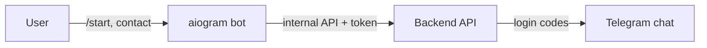

# Nazar Education — Telegram Bot

> Telegram bot that securely links a user's Telegram account to their phone number so login codes can be delivered for free via Telegram instead of SMS.

-FC6D26?style=flat-square&logo=gitlab)

## Overview
In the Nazar Education system the login is a phone number and the one-time code is sent through Telegram (free and instant, compared to paid SMS). This small, separately deployed service onboards users: it verifies that the shared contact belongs to the sender and binds the Telegram account to the existing user record in the [backend](../nedu-backend/). The codes themselves are sent by the backend, so login keeps working even if the bot is down. It serves the [staff panel](../nedu-administration/) and [mobile app](../nedu-mobile-app/) login flows.

## Key Features
- `/start` onboarding with a "share phone number" button (numbers cannot be typed manually, only Telegram-verified contacts are accepted).
- Contact-ownership check: requests where the shared contact is not the sender's own are rejected before reaching the backend.
- Clear handling of edge cases: already linked, number not registered, Telegram account already bound to another user.
- No database access: talks to the backend only through two internal endpoints protected by a shared service token.
- Fail-fast configuration validation on startup (also checked in CI).
- Long polling (no public port or webhook certificate needed); auto-restart via container policy.
- Planned next: parent dashboard (attendance, debts, results), automatic notifications and a daily owner summary.

## Architecture

## Tech Stack
| Layer | Technologies |
|---|---|
| Runtime | Python 3.12, aiogram 3, aiohttp |
| Quality | pytest, pytest-asyncio, ruff |
| Ops | uv, Docker, GitLab CI (lint, test, build, smoke, deploy) |

## My Role
Design and implementation of the bot and its integration with the backend authentication flow, including the security checks and deployment.

## 🔒 Source Code Access
The source code of this project is kept in a **private GitLab repository** (client / commercial project).
It is not published here. On request, I can walk through the codebase, architecture and live demo
in a **separate video call** for discussion.
