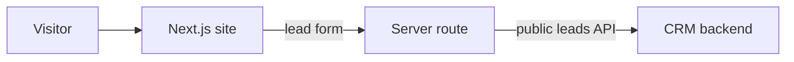

# Nazar Education — Landing Website

> SEO-optimised marketing site for the Nazar Education learning center that turns visitors into CRM leads.

-FC6D26?style=flat-square&logo=gitlab)

## Overview
The public face of Nazar Education (nazareducation.uz), a tutoring center in Chirchiq, Uzbekistan. The site presents courses, teachers, student results and national certificates, and collects enrollment requests. Submitted forms are forwarded server-side into the CRM of the [backend](../nedu-backend/), where they appear in the staff panel's lead pipeline ([../nedu-administration/](../nedu-administration/)).

## Key Features
- Interactive single-page landing: course catalogue with category filters, teacher cards, animated statistics, testimonials, FAQ and a certificate gallery.
- Lead form with phone normalisation to E.164 and UTM-parameter capture for marketing attribution.
- Server-side lead proxy route: avoids CORS, hides the backend address from the browser, forwards the real client IP / user agent for anti-spam, and handles timeouts and rate-limit responses with user-friendly messages.
- Full SEO setup: canonical URLs, generated `sitemap.xml` and `robots.txt`, web manifest, JSON-LD structured data and dynamically rendered Open Graph / Twitter images.
- Search-engine verification hooks (Google Search Console, Yandex Webmaster) via environment configuration.
- Legal pages (terms of use, privacy policy) with a shared layout.
- Containerised build and GitLab CI pipeline.

## Architecture

## Tech Stack
| Layer | Technologies |
|---|---|
| Framework | Next.js (App Router), React, TypeScript |
| UI | Custom CSS, Radix UI Select, lucide-react icons |
| SEO | Next.js metadata routes, JSON-LD, generated OG images |
| Ops | Docker, GitLab CI |

## My Role
Front-end development and integration of the lead form with the CRM backend; SEO setup and deployment.

## 🔒 Source Code Access
The source code of this project is kept in a **private GitLab repository** (client / commercial project).
It is not published here. On request, I can walk through the codebase, architecture and live demo
in a **separate video call** for discussion.
