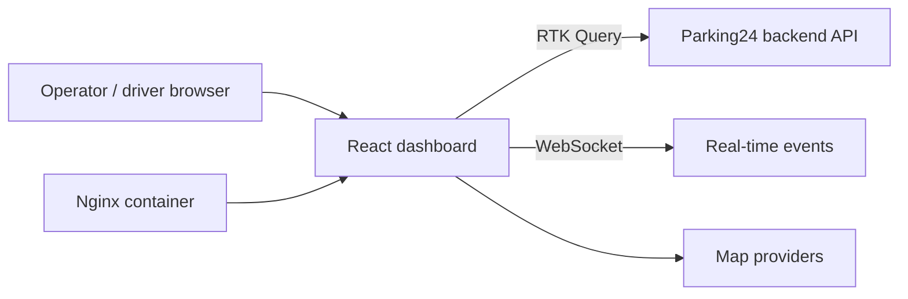

# Parking24 Dashboard

> Real-time parking management dashboard for operators and drivers: permits, vehicles, payments, invoices and parking zones on a map.

-FC6D26?style=flat-square&logo=gitlab)

## Overview
Parking24 is a parking platform; this repository is its web dashboard. It gives parking operators tools to manage
permits, vehicles, watchlists, points of sale and billing, and lets users view their own permits and invoices.
It combines map-based visualisation with real-time updates and document/report export.

## Key Features
- Authentication with role-based access (including a no-role landing state) and Google sign-in
- Parking permits management, plus a "My Permits" view for end users
- Vehicles registry and plate-number watchlist
- POS (point-of-sale) management with multiple payment terminal types, and POC records
- Invoices, payments and tariff plans
- Visitors management
- Interactive maps (Yandex Maps, Leaflet with marker clustering) for parking locations
- Real-time updates over WebSocket; QR code generation and scanning
- Export to PDF and Excel, document preview; multi-language UI (i18next)
- Mobile-friendly layout, PWA service worker

## Architecture

## Tech Stack
| Layer | Technologies |
|---|---|
| UI | React 18, TypeScript, Ant Design 5, Sass modules (BEM), Framer Motion |
| State / data | Redux Toolkit + RTK Query, react-use-websocket |
| Maps | Yandex Maps, Leaflet + markercluster, geolib |
| Documents | jsPDF, KendoReact PDF, SheetJS (xlsx), docx-preview, pdf.js |
| i18n | i18next |
| Tooling | Create React App (react-app-rewired), ESLint, Prettier, Husky, lint-staged, Plop |
| Delivery | Docker (dev + multi-stage Nginx), docker-compose, Makefile, GitLab CI |

## My Role
Frontend development within the team: fixes and features for POS, POC and permits modules, mobile layout
improvements, and merging/review of development branches.

## 🔒 Source Code Access
The source code of this project is kept in a **private GitLab repository** (client / commercial project).
It is not published here. On request, I can walk through the codebase, architecture and live demo
in a **separate video call** for discussion.
