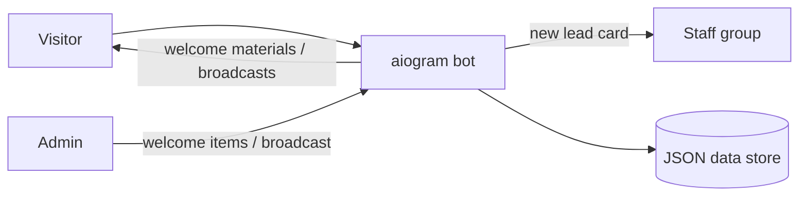

# Clinic Assistant Bot (doctor-odilbek-bot)

> Lead-capture and content-delivery Telegram bot for a medical practice: collects visitor contacts, forwards new leads to the team and delivers admin-curated welcome materials and broadcasts.

-FC6D26?style=flat-square&logo=gitlab)

## Overview
A doctor's practice promoted itself on social media and needed a simple way to turn interested visitors into contactable leads and then keep them informed. This bot asks each new user to share their phone number and name, posts a structured "new request" card to the team's Telegram group, and then sends a configurable series of welcome materials. Admins manage that content and send broadcasts from a password-protected in-bot panel.

## Key Features
- **Contact capture onboarding** — request-contact button plus full-name step implemented with aiogram FSM states.
- **Lead notifications** to a staff group with the lead's details, timestamp and source.
- **Configurable welcome sequence** — admins add, list and clear welcome items (text, photo, video, document) sent to each new user.
- **Broadcasts** of any message type to all registered users, with sent / failed counters and rate-friendly pacing.
- **Statistics command** showing user counts.
- **Password-protected admin mode** with login / logout commands.
- **Modular structure** — separate routers for start, admin, welcome, broadcast and stats.
- **Docker deployment** with a GitLab CI pipeline.

## Architecture

## Tech Stack
| Layer | Technologies |
|-------|--------------|
| Language | Python |
| Bot framework | aiogram 3 (routers, FSM) |
| Data / config | JSON file store, Pydantic, python-decouple, aiofiles |
| DevOps | Docker, Docker Compose, GitLab CI/CD |

## My Role
Freelance development for the client: bot design and implementation, admin tooling, deployment.

## 🔒 Source Code Access
The source code of this project is kept in a **private GitLab repository** (client / commercial project).
It is not published here. On request, I can walk through the codebase, architecture and live demo
in a **separate video call** for discussion.
