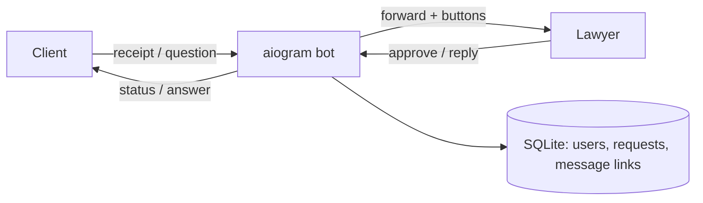

# Legal Consultation Bot (gulmira-bot)

> Telegram bot for a practising lawyer that sells paid consultations: clients pay, upload a receipt, ask their question and receive the lawyer's answer — all inside Telegram.

-FC6D26?style=flat-square&logo=gitlab)

## Overview
An independent lawyer wanted to offer paid Q&A consultations without managing payments and questions across scattered chats. This bot acts as a structured intermediary between clients and the lawyer: it enforces "pay first, then ask", routes receipts and questions to the lawyer, and relays the lawyer's replies back to the right client while keeping the lawyer's personal account private. Built in 2026.

## Key Features
- **Request lifecycle state machine** — each client request moves through *waiting for receipt check → approved → in progress → completed* (or *rejected*), persisted in SQLite.
- **Payment receipt intake** — photo or PDF receipts (PDF detected by MIME type or file extension) forwarded to the lawyer with inline Approve / Reject buttons.
- **Status-aware guidance** — clients get context-specific instructions depending on where their request is (payment instructions, pending check, question already sent, etc.).
- **Question routing** — once payment is approved, the client's text question is delivered to the lawyer with a request reference.
- **Reply relay** — the lawyer simply replies to the forwarded question; the bot copies the answer (text or media) back to the correct client and closes the request.
- **Lawyer-side status captions** — approved / rejected marks appended to receipt messages, buttons removed after a decision.
- **Robust error handling** for blocked or unreachable chats without corrupting request state.
- **Docker image** built and published through GitLab CI.

## Architecture

## Tech Stack
| Layer | Technologies |
|-------|--------------|
| Language | Python |
| Bot framework | aiogram 3 |
| Storage | SQLite |
| Config | python-dotenv |
| DevOps | Docker, Docker Compose, GitLab CI/CD |

## My Role
Freelance development for the client: workflow design, bot implementation, data model, deployment.

## 🔒 Source Code Access
The source code of this project is kept in a **private GitLab repository** (client / commercial project).
It is not published here. On request, I can walk through the codebase, architecture and live demo
in a **separate video call** for discussion.
