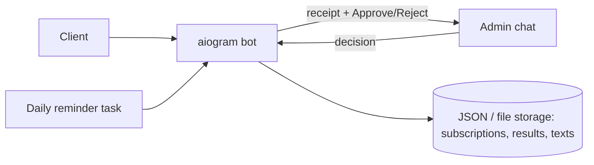

# Royal Trade Bot

> Telegram bot for a forex-trading community: handles paid VIP-membership onboarding, payment-receipt review, subscription reminders and showcasing trading results.

-FC6D26?style=flat-square&logo=gitlab)

## Overview
The client runs a trading-signals channel with a paid VIP tier and was handling sign-ups, payments and renewals manually in chat. This bot moves that workflow into Telegram: prospective members see connection terms and payment details, upload a payment receipt, and the admin approves or rejects it with one tap; the bot then collects the member's trading-account details for onboarding and reminds them before the 30-day subscription expires. Built in 2026.

## Key Features
- **Client menu** — connection (VIP) info with payment requisites, trading results, recommended brokers and contact links.
- **Receipt submission** — photos, image documents or PDFs are forwarded to the admin chat with the sender's info and inline Approve / Reject buttons.
- **Admin review flow** — approval activates a 30-day subscription and starts a guided FSM dialogue to collect the member's MT5 account details for onboarding.
- **Subscription reminders** — automatic daily reminders during the last days of each 30-day period, sent once per day per member.
- **Results gallery** — admin uploads screenshots in a dedicated mode; clients can browse all saved results.
- **Editable texts** — admin can update the connection/onboarding message from inside the bot.
- **Role separation** between admin and client handlers using aiogram routers.
- **Containerised deployment** — Docker image built and pushed by GitLab CI.

## Architecture

## Tech Stack
| Layer | Technologies |
|-------|--------------|
| Language | Python 3.12 |
| Bot framework | aiogram 3 (routers, FSM, inline keyboards) |
| Storage | JSON files, local image storage |
| DevOps | Docker, Docker Compose, GitLab CI/CD (container registry) |

## My Role
Freelance development for the client: bot design, admin and client flows, subscription logic, deployment.

## 🔒 Source Code Access
The source code of this project is kept in a **private GitLab repository** (client / commercial project).
It is not published here. On request, I can walk through the codebase, architecture and live demo
in a **separate video call** for discussion.
