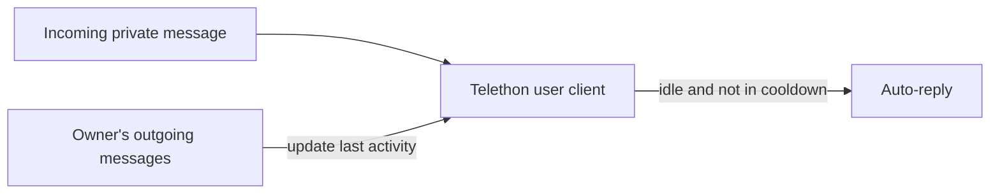

# Telegram Auto-Reply

> A lightweight "away message" for a personal Telegram account: automatically replies to private messages when the owner has been inactive for a while.

-FC6D26?style=flat-square&logo=gitlab)

## Overview
Telegram does not offer a built-in away message for regular (non-Business) accounts. This small personal-use tool runs as a Telegram user client: it tracks the owner's own outgoing activity and, when someone writes in a private chat while the owner has been idle, sends a trilingual (Uzbek / Russian / English) "currently unavailable" reply. It is deliberately minimal — a single-module service packaged in Docker.

## Key Features
- **Activity-based presence detection** — any outgoing message marks the owner as active; after a configurable idle period the account is treated as offline.
- **Automatic replies in private chats only**, ignoring groups, bots and the owner's own messages.
- **Per-contact cooldown** so each person receives the auto-reply at most once within a configurable window (hours), avoiding spam.
- **Trilingual reply template** (Uzbek, Russian, English) with Markdown formatting.
- **Persistent session** stored in a mounted volume so the container can restart without re-login.
- **Docker / Docker Compose deployment** with a GitLab CI pipeline.

## Architecture

## Tech Stack
| Layer | Technologies |
|-------|--------------|
| Language | Python |
| Telegram | Telethon (user client) |
| Config | python-dotenv |
| DevOps | Docker, Docker Compose, GitLab CI/CD |

## My Role
Personal project — sole developer (idea, implementation, deployment).

## 🔒 Source Code Access
The source code of this project is kept in a **private GitLab repository** (client / commercial project).
It is not published here. On request, I can walk through the codebase, architecture and live demo
in a **separate video call** for discussion.
