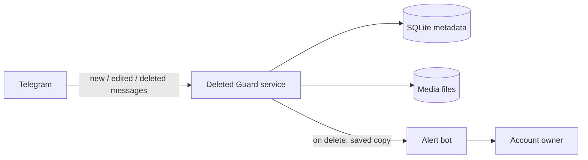

# Telegram Deleted Guard

> Archives incoming private Telegram messages as they arrive and alerts the account owner with the saved copy when a sender uses "Delete for everyone".

-FC6D26?style=flat-square&logo=gitlab)

## Overview
Telegram lets a sender delete a private message for both sides, and the deletion update does not carry the original content. This service solves that by archiving every incoming private message (text and media) the moment it arrives, so that when a deletion event comes in, the stored copy can be delivered to the owner through an alert bot. It runs 24/7 on a VPS as a Docker container and was developed in 2026.

## Key Features
- **Two operating modes:** a user-session client (Telethon, MTProto) and a **Telegram Business connected-chatbot** mode that needs no user session — the bot is attached to Premium accounts via Telegram Business settings.
- **Multi-user Business mode:** several accounts can connect the same bot; each owner only receives alerts about their own chats, with an allow-list and an admin who receives access requests.
- **Full content archiving:** text, voice, photos, video, audio, video notes, documents and other media.
- **Edit tracking:** keeps both the original and the latest version of edited messages.
- **Deletion alerts** — re-sends the archived text or media to the owner via the alert bot.
- **Size-aware media handling** respecting Bot API download / upload limits; oversized files are kept on the server and reported instead.
- **Storage hygiene:** metadata in SQLite, media on disk, with archived media dropped once delivered to the owner.
- **Interactive first-login script** (including 2FA) for the user-session mode.
- **Containerised deployment** with Docker Compose and a GitLab CI pipeline that builds and deploys a pinned image tag.

## Architecture

## Tech Stack
| Layer | Technologies |
|-------|--------------|
| Language | Python (asyncio) |
| Telegram | Telethon (MTProto user client), Telegram Bot API incl. Business updates |
| HTTP | httpx |
| Storage | SQLite (aiosqlite), local file storage |
| DevOps | Docker, Docker Compose, GitLab CI/CD |

## My Role
Design and development of the whole service: Telegram integration in both modes, archiving and alerting logic, storage, Docker packaging and CI/CD deployment.

## 🔒 Source Code Access
The source code of this project is kept in a **private GitLab repository** (client / commercial project).
It is not published here. On request, I can walk through the codebase, architecture and live demo
in a **separate video call** for discussion.
