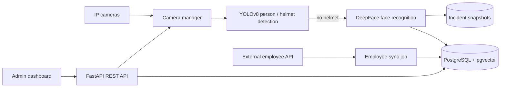

# Helmet Detector

> AI-powered video analytics service that detects workers without safety helmets on live IP-camera feeds, identifies them by face and logs safety incidents.

-FC6D26?style=flat-square&logo=gitlab)

## Overview
In railway repair depots, hard-hat compliance is a core workplace-safety requirement, but manual monitoring of every work area is impractical. This backend service consumes live IP-camera streams, runs object detection to find people and helmets, and when someone is not wearing a helmet it crops the face, matches it against the employee database and records an incident with a snapshot. It was built in summer 2025 for Uzbekistan Railways alongside the depot website ([vchd-api](../vchd-api/), [vchd-ui](../vchd-ui/)).

## Key Features
- **Real-time stream processing** of multiple IP cameras, each managed independently (add, start, stop, start-all-active, status).
- **Person and helmet detection** with a YOLOv8 model.
- **Face recognition** of violators using DeepFace, with employee face embeddings stored in PostgreSQL via pgvector.
- **Incident logging** — time, matched employee, camera location and saved evidence image.
- **Employee synchronisation** — scheduled / on-demand import of employee photos from an external HR API and embedding generation (APScheduler + httpx).
- **REST API** for cameras, employees and incidents, intended for an admin dashboard.
- **GPU acceleration** on NVIDIA GPUs (CUDA / cuDNN, NVIDIA Container Toolkit) with a CPU fallback mode for local development.
- **Database migrations** with Alembic; tests directory and Docker Compose setup for deployment.

## Architecture

## Tech Stack
| Layer | Technologies |
|-------|--------------|
| Language | Python 3.12 |
| API | FastAPI, Gunicorn / Uvicorn |
| Computer vision | Ultralytics YOLOv8, DeepFace, ffmpeg |
| Data | PostgreSQL, pgvector, SQLAlchemy, Alembic |
| Background jobs | APScheduler, httpx |
| Infrastructure | Docker, Docker Compose, NVIDIA CUDA / cuDNN, GitLab CI/CD |

## My Role
Full backend and ML integration: video pipeline design, model integration (detection and face recognition), database and vector storage, REST API, employee data synchronisation, GPU-enabled containerised deployment.

## 🔒 Source Code Access
The source code of this project is kept in a **private GitLab repository** (client / commercial project).
It is not published here. On request, I can walk through the codebase, architecture and live demo
in a **separate video call** for discussion.
