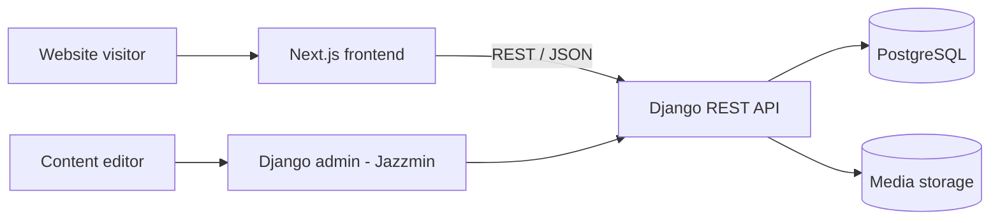

# VChD API — Bukhara Wagon Depot Backend

> REST backend and admin panel powering the public website of the Bukhara Wagon (Carriage) Depot, a division of Uzbekistan Railways.

-FC6D26?style=flat-square&logo=gitlab)

## Overview
The wagon depot needed a simple, maintainable corporate website where staff can manage the list of services it offers and receive enquiries from visitors. This repository is the backend: a Django application that exposes a small REST API consumed by the Next.js frontend ([vchd-ui](../vchd-ui/)) and provides a Django admin panel for content editors. Development took place in September 2025.

## Key Features
- **Services catalogue** — services with title, description, photo and auto-generated slug, exposed as list and detail API endpoints.
- **Multilingual content** — service titles and descriptions translated per language via django-modeltranslation (Uzbek / Russian site).
- **Contact form intake** — public endpoint that validates and stores visitor messages (name, contact details, text) for staff review.
- **Admin panel** — Django admin themed with Jazzmin for non-technical content managers.
- **API documentation** — Swagger / OpenAPI schema generated with drf-yasg.
- **CORS and CSRF configuration** for the separately hosted frontend.
- **Media handling** — image uploads for services via Pillow, static files collected for production.
- **Containerised deployment** — Docker image served by Gunicorn, with a GitLab CI pipeline that builds and deploys to the production server (manual approval step, migrations and collectstatic run automatically).

## Architecture

## Tech Stack
| Layer | Technologies |
|-------|--------------|
| Language | Python 3.12 |
| Framework | Django 5.2, Django REST Framework |
| i18n | django-modeltranslation |
| Admin | Django admin, Jazzmin |
| API docs | drf-yasg (Swagger) |
| Database | PostgreSQL (psycopg2) |
| Serving | Gunicorn |
| DevOps | Docker, Docker Compose, GitLab CI/CD |

## My Role
Backend development: data modelling, REST API design, multilingual content setup, admin configuration, containerisation and CI/CD deployment pipeline.

## 🔒 Source Code Access
The source code of this project is kept in a **private GitLab repository** (client / commercial project).
It is not published here. On request, I can walk through the codebase, architecture and live demo
in a **separate video call** for discussion.
