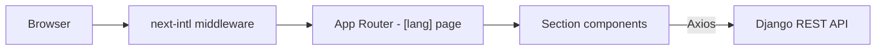

# VChD UI — Bukhara Wagon Depot Website

> Bilingual (Uzbek / Russian) corporate website for the Bukhara Wagon (Carriage) Depot of Uzbekistan Railways.

-FC6D26?style=flat-square&logo=gitlab)

## Overview
The depot repairs freight wagons and performs on-site technical maintenance; it needed a public web presence describing its work, services and leadership, with a way for visitors to get in touch. This repository is the frontend: a single-page, locale-routed Next.js site that pulls services from the Django backend ([vchd-api](../vchd-api/)) and submits contact-form messages to it.

## Key Features
- **Locale-based routing** (`/uz`, `/ru`) with next-intl middleware and per-language message catalogues.
- **Landing sections** — hero banner, statistics counters, about, photo gallery, leadership, services, useful government links and footer.
- **Dynamic services block** loaded from the backend REST API via a shared Axios client, with loading state.
- **Contact / feedback form** posting visitor enquiries to the backend.
- **Gallery and carousels** built with Swiper; scroll and entrance animations with AOS and Framer Motion.
- **Responsive UI** combining Tailwind CSS 4 utilities with MUI components and icon sets (MUI Icons, Lucide, React Icons).
- **Containerised build** with a Dockerfile and GitLab CI pipeline.

## Architecture

## Tech Stack
| Layer | Technologies |
|-------|--------------|
| Framework | Next.js 15 (App Router, Turbopack), React 19 |
| Styling | Tailwind CSS 4, MUI 7, Emotion / styled-components |
| i18n | next-intl (Uzbek, Russian) |
| UI / motion | Swiper, AOS, Framer Motion, Lucide, React Icons |
| Data | Axios |
| Tooling | ESLint, Yarn |
| DevOps | Docker, GitLab CI/CD |

## My Role
Frontend development: page layout and components, internationalisation, API integration with the backend, animations and responsive design, containerised deployment.

## 🔒 Source Code Access
The source code of this project is kept in a **private GitLab repository** (client / commercial project).
It is not published here. On request, I can walk through the codebase, architecture and live demo
in a **separate video call** for discussion.
